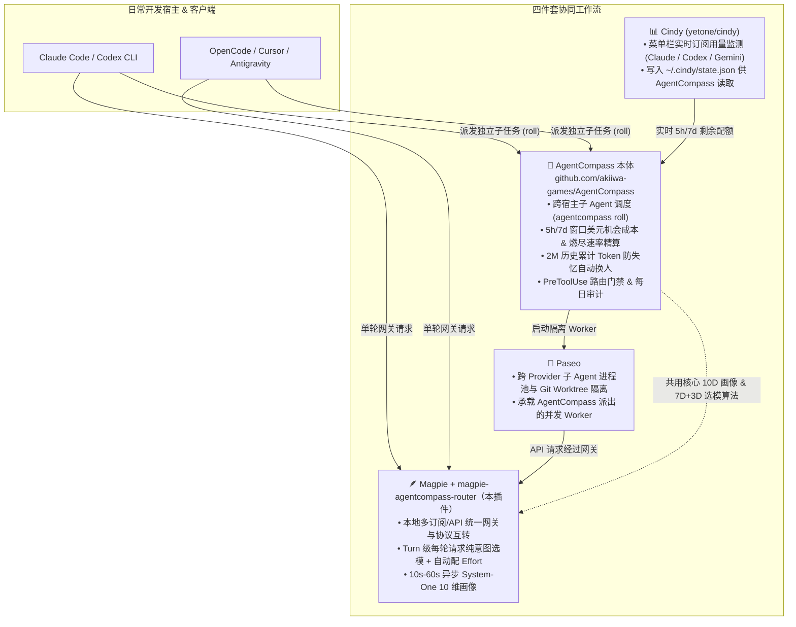

# magpie-agentcompass-router

> **Pure Intent & Capability Routing Plugin for [Magpie](https://github.com/yetone/magpie), powered by the core routing algorithm of [AgentCompass](https://github.com/akiiwa-games/AgentCompass).**
>
> 为 [Magpie](https://github.com/yetone/magpie) 打造的**纯意图与能力矩阵路由插件**——突破 Magpie 同步插件 20ms/250ms 时间预算限制，拿到 **10s–60s** 充裕推理预算，直接运行 **[AgentCompass](https://github.com/akiiwa-games/AgentCompass)** 本体的 **10 维任务画像 + 7 维模型能力向量 + 3 维主观禀赋（Model DNA）+ 思考档位投入曲线** 核心算法。

---

## 🔗 与 [AgentCompass 本体](https://github.com/akiiwa-games/AgentCompass) 的关系及生态协同（Magpie + Cindy + Paseo）

本插件将 **[AgentCompass](https://github.com/akiiwa-games/AgentCompass)** 的核心选型引擎（`route_judge.py` + `allocator.py` 的纯意图路由内核）提取并移植为原生 Magpie 插件。

如果你不仅需要在网关单次请求（Turn 级）做精准意图路由，还需要**跨工具的多 Agent 任务编排、5h/7d 订阅额度机会成本精算、2M 历史上下文防失忆换人、以及多宿主统一门禁**，强烈建议将本插件与 **[AgentCompass 本体（`https://github.com/akiiwa-games/AgentCompass`）](https://github.com/akiiwa-games/AgentCompass)** 配合 **[Magpie](https://github.com/yetone/magpie)**、**[Cindy](https://github.com/yetone/cindy)**、**Paseo** 共同使用：



### 四件套各自解决什么问题？

| 组件 | 定位与职责 | 与 [AgentCompass 本体](https://github.com/akiiwa-games/AgentCompass) 共用时的增益 |
| :--- | :--- | :--- |
| **[AgentCompass 本体](https://github.com/akiiwa-games/AgentCompass)** | **跨宿主总调度器（Macro-Orchestrator）**<br/>管理 Claude Code、Codex、OpenCode、Antigravity、Dot、Grok 等所有子 Agent 派工与额度护栏 | 提供 `agentcompass roll` 一键拆单/派工、5h/7d 窗口美元价值最大化、2M 累计上下文强制交接换人、以及 `PreToolUse` 门禁 |
| **[Magpie](https://github.com/yetone/magpie) + 本插件** | **本地网关与单轮意图路由器（Micro-Router）**<br/>在 HTTP 网关层拦截每次 LLM 调用，按 Prompt 真实难度动态改写 `<model>:<effort>` | 当主会话不派子 Agent、直接在客户端对话时，由本插件在网关层自动把简单问答切给快模型、把复杂排障/架构切给顶配模型并挂上合适 `effort` |
| **[Cindy](https://github.com/yetone/cindy)** | **实时订阅配额遥测（Quota Telemetry）**<br/>常驻状态栏采集各家 Pro/Max 账号的 5h / 7d 窗口用量与重置时间 | Cindy 产出的 `~/.cindy/state.json` 可直接被 AgentCompass 本体读取，让每次派工不仅看任务意图，还实时避开即将限流的账号 |
| **Paseo** | **多 Agent 并发运行时（Execution Runtime）**<br/>管理后台 Worker 会话生命周期、跨 worktree 并发开发与父子 Agent 消息通信 | AgentCompass 本体计算出最优 `<provider>/<model>:<effort>` 后，直接通过 Paseo 启动带显式权限模式与父会话回调契约的 Worker |

---

## ❓ 为什么需要这个插件？（Magpie 原生路由的痛点与时间预算突破）

直接阅读 Magpie 源码（`internal/gateway/`、`internal/middleware/`、`internal/plugin/`）可以发现，Magpie 原生路由与同步插件存在两个核心瓶颈：

1. **同步 JS 插件时间预算极短，且 Pool Strategy 拿不到 Prompt**：
   - `strategies[name](pool, seats, options)` 运行在内置 `moejs` 沙箱中，**硬超时仅 `20 ms`**（`strategyLimit = 20 * time.Millisecond`），且入参只有账号槽位数组，**完全看不到用户的请求正文与意图**。
   - `magpie.middleware`（`onRequest`）同样运行在无网络的 `moejs` 沙箱中，**硬超时仅 `250 ms`**（`requestLimit = 250 * time.Millisecond`），无法发起外部 System-One 小模型分类请求。
2. **原生 Routing Group 规则过于扁平**：
   - Magpie 原生 `classify.go` + `rules.go` 只向分类器询问单一的 1D `intent` 标签和 `0..3` 的整数 `effort`，再按静态列表映射模型；
   - 缺少多维能力向量匹配（如 `code` vs `reasoning` vs `context` vs `rigor`）、缺少模型主观禀赋区分（擅长发散脑暴的 `Gemini 4 Argon` vs 擅长跨模块严密推演的 `Claude Opus 5.5` vs 擅长单模块高精度代码的 `GPT-6.1 Sol`）、缺少连续能力底线（`required_ability` floor）与杀鸡用牛刀惩罚（`overqualification penalty`）。

### 💡 本插件如何合法拿到 10s–60s 时间预算？

我们通过分析 Magpie 的请求管线（`internal/gateway/middleware.go:serveAgent` 与 `internal/gateway/decide.go`），设计了**双模式长预算架构**，无需修改 Magpie 任何一行源码：

#### 模式 A：两阶段接力直改模型（`magpie.hooks` [Bun, 10,000 ms] $\rightarrow$ `magpie.middleware` [`moejs`, 250 ms]）
在 `internal/gateway/middleware.go:serveAgent` 中：
1. **第一阶段（`src/hooks.js`，Bun 运行时，最长 `10,000 ms` 预算）**：
   - Magpie 先执行 `gatewayHooks`（第 39 行），默认超时 `1200 ms`，可通过插件配置或环境变量 `AGENTCOMPASS_GATEWAY_TIMEOUT_MS=8000` 提升至 **`10,000 ms`（10 秒）**！
   - `src/hooks.js` 在完整的 Bun 异步环境中调用外部或本地 System-One 模型（支持 Jev `/v1/systemone`、任意 OpenAI 兼容快模型、以及毫秒级确定性启发式兜底），生成 [AgentCompass](https://github.com/akiiwa-games/AgentCompass) 的 **10 维结构化任务画像**，并运行完整的 `selectBestRoute()` 算法算出最优 `<targetModel>:<targetEffort>`。
   - **绕过 `host.js:1411` 限制**：Magpie 的 `host.js` 禁止 `hooks` 直接修改 `body.model` / `tools` / `stream`，但允许写入自定义元数据字段。因此 `hooks.js` 将选型结果写入 `body.__agentcompass_route`。
2. **第二阶段（`src/middleware.js`，`moejs` 运行时，`< 0.2 ms` 完成）**：
   - 紧接着（第 42 行），Magpie 执行 `gwmw.Agent`（`src/middleware.js`）。
   - `middleware.js` 读取并删除 `body.__agentcompass_route`，直接将 `body.model` 改写为 `<targetModel>:<targetEffort>`（Magpie `gateway.go:1560` 的 `askedAt()` 原生支持 `<model>:<effort>` 语法并自动设置请求思考档位！）。

#### 模式 B：原生 Routing Group 决策 Provider（`decide: true` / `/v1/systemone`，8,000 ms – 60,000 ms 预算）
- `src/index.js` 同时注册了一个拥有 `decide: true` 能力的 Magpie Provider（`agentcompass-router`）及决策模型 `agentcompass-systemone`（`decides: true`）。
- 当你在 Magpie UI 的 **Routing Group -> Classifier** 中选择 `agentcompass-router/agentcompass-systemone` 时，Magpie 的 `askJev`（`internal/gateway/decide.go:132`）会赋予它 `Settings.ClassifyTimeout` 的专属预算（**默认 `8,000 ms`，最高可在 Magpie 设置中调至 `60,000 ms` = 60 秒**）。
- 插件完整兼容 Magpie 的两套 `/v1/systemone` 协议（`jevLevelled` 两级分类与 `jevBody` 单级分类），并在后台用完整的 10 维画像 + 7D/3D 向量算法把最优路由反推回你配置的 Routing Group 规则与 `effort`（`low` / `medium` / `high` / `xhigh`）。

---

## 🧠 核心算法：10 维任务画像 × (7 维客观能力 + 3 维主观禀赋)

本插件完整移植了 [AgentCompass (`E:\PROJECTS\route_manager`)](https://github.com/akiiwa-games/AgentCompass) 的纯意图选型公式（详见 [`src/allocator.js`](./src/allocator.js) 与 [`src/profiler-core.js`](./src/profiler-core.js)）：

### 1. 10 维任务画像（Task Profile）
每次请求都会被剖析为 10 个正交维度：
- `work_kind`（16 类标准工作形态：`routine_execution`、`self_contained_code`、`repo_implementation`、`architecture_refactor`、`debugging_root_cause`、`direction_reasoning`、`frontier_research`、`verification_audit`、`writing_polishing` 等）
- `difficulty`（`easy` / `medium` / `hard` / `max`）
- `reasoning_depth`（`1..4`）：逻辑推演深度与未知根因排查复杂度
- `code_complexity`（`0..4`）：代码修改跨度与状态机耦合度（只读审查强制归零）
- `context_ breadth`（`1..4`）：上下文广度与跨文件/长日志规模
- `tool_intensity`（`0..3`）：工具链调用密集度
- `rigor_need`（`1..4`）：工程严密性与零回归要求
- `divergence_need`（`0..3`）：发散创意、第一性原理脑暴需求
- `global_rigor_need`（`0..3`）：跨系统全局不变量与长链路一致性需求
- `module_precision_need`（`0..3`）：单模块契约、Schema 与边界条件精确度需求

### 2. 候选 `<model, effort>` 综合效用函数
对每一个候选模型与思考档位组合 $(m, e)$，插件计算：

$$\text{pure\_intent\_score}(m, e) = \text{fit\_score}(m, e) - \text{overqual\_penalty}(m, e) - \text{effort\_Selectivity\_penalty}(m, e)$$

其中：
- **思考档位缩放（Effort Scaling）**：不同思考档位（`low` / `medium` / `high` / `xhigh` / `max`）按 `EFFORT_CURVES` 动态缩放模型的 `reasoning`、`rigor`、`autonomy` 等能力维度；
- **7 维客观能力拟合（Convergent Fit）**：加权点积匹配 `reasoning`、`code`、`context`、`tool_use`、`rigor`、`speed`、`autonomy`，并对低于任务硬性门槛（`min_reasoning` / `min_code` / `min_rigor`）的候选施加缺口惩罚（`deficit * 14.0`）；
- **3 维模型主观禀赋（Subjective Model DNA）**：
  - `divergence`（发散与创意突破：如 `gemini-4-argon-high` = `95`）
  - `global_rigor`（全局架构与深水区排障：如 `claude-opus-5-5` = `97`、`gpt-6-astra` = `94`）
  - `module_precision`（单模块精准实现：如 `gpt-6.1-sol` = `95`、`gpt-6.1-terra` = `89`）
- **双模融合权重**：收敛型任务（`convergence_weight = 0.80`）以硬指标为主；发散/脑暴型任务（`divergence_weight = 0.45`）大幅提升主观禀赋权重；
- **防杀鸡用牛刀（Overqualification & Effort Selectivity）**：当任务需求（`task_demand`）较低时，自动惩罚过高模型与过高 `effort`（如 `xhigh` / `max` 仅在 `task_demand >= 82` 或 `reasoning_depth >= 4` 时解锁）。

---

## 📦 安装与接入指南

### 1. 获取插件

```bash
git clone https://github.com/akiiwa-games/magpie-agentcompass-router.git
cd magpie-agentcompass-router
```

将插件软链接或复制到 Magpie 的插件目录（`~/.magpie/plugins/`）：

```bash
# Linux / macOS
ln -s "$(pwd)" ~/.magpie/plugins/magpie-agentcompass-router

# Windows (PowerShell)
New-Item -ItemType SymbolicLink -Path "$HOME\.magpie\plugins\magpie-agentcompass-router" -Target (Get-Location).Path
```

---

### 2. 配置方式一（推荐）：模式 A —— 两阶段接力直改 `<model>:<effort>`（10s 时间预算）

在模式 A 下，客户端只需发送虚拟模型名（如 `model: "auto"`、`model: "agentcompass"`，或开启 `routeAllModels: true` 拦截全部请求），插件就会在网关层自动计算最佳 `<model>:<effort>` 并转发给对应上游。

在 `~/.magpie/config.json`（或插件配置）中设置：

```json
{
  "plugins": {
    "magpie-agentcompass-router": {
      "gatewayTimeoutMs": 8000,
      "routeModelTriggers": ["auto", "agentcompass", "compass", "smart", "default"],
      "routeAllModels": false,
      "allowedModels": [
        "claude-opus-5-5",
        "claude-sonnet-5-5",
        "claude-haiku-5-5",
        "gpt-6-astra",
        "gpt-6.1-sol",
        "gpt-6.1-terra",
        "gpt-6-luna",
        "gemini-4-argon-high",
        "gemini-3.8-flash-high"
      ],
      "modelMap": {
        "claude-opus-5-5": "claude-opus-4-6",
        "claude-sonnet-5-5": "claude-sonnet-4-6",
        "claude-haiku-5-5": "claude-haiku-4-5"
      },
      "scorer": {
        "kind": "openai_compatible",
        "baseUrl": "http://127.0.0.1:3000/v1",
        "apiKey": "your-key-or-magpie-local-token",
        "model": "gpt-5.4-nano",
        "timeoutMs": 6500
      }
    }
  }
}
```

> **提示**：
> - 如果不配置外部 `scorer.baseUrl`，插件会默认使用 `< 1 ms` 零延迟的确定性 10 维启发式画像器（`kind: "heuristic"`），同样运行完整的 10D × (7D+3D) 选模算法。
> - 如果将 `scorer.baseUrl` 指向 Magpie 自身（如 `http://127.0.0.1:3000/v1`），插件会自动附带 `User-Agent: Magpie-Router/1.0` 请求头，触发 Magpie `rules.go:196` 的内置防递归保护，绝不会产生死循环！
> - `modelMap` 可将 AgentCompass 标准模型 ID 映射为你 Magpie 网关里实际配置的模型 ID。

---

### 3. 配置方式二：模式 B —— 作为 Magpie Routing Group 原生 Classifier（最高 60s 时间预算）

如果你喜欢使用 Magpie UI 的 **Routing Groups（路由组）** 可视化界面：

1. 在 Magpie 中添加本插件提供的 Provider：`AgentCompass Pure Intent Router (agentcompass-router)`；
2. 进入你的 **Routing Group** 设置，将 **Classifier（分类器模型）** 选择为 `agentcompass-router/agentcompass-systemone`；
3. 在 Magpie 全局设置中，可将 `ClassifyTimeout` 调整为 `8000`–`30000` ms（最高支持 `60000` ms）；
4. 在 Routing Group 中按标准类别（如 `code`、`debug`、`research`、`writing`、`quick`）配置你的目标模型列表——插件会自动运行 AgentCompass 算法，选出最匹配的规则分支与思考档位（`low` / `medium` / `high` / `xhigh`）。

---

## 🧪 运行测试

本仓库内置完整的零依赖单元测试套件（覆盖多协议解析、10 维画像推断、能力向量选型、两阶段 `hooks -> middleware` 接力及 `/v1/systemone` 协议兼容）：

```bash
node --test test/router.test.mjs
```

---

## 📂 仓库目录结构

- [`package.json`](./package.json) — Magpie 插件清单（同时挂载 `main`、`magpie.hooks`、`magpie.middleware`）
- [`src/catalog.js`](./src/catalog.js) — 16 类 `work_kind`、13 个核心模型 7D 能力向量 + 3D 主观禀赋（Model DNA）、Effort 投入曲线与默认策略
- [`src/profiler-core.js`](./src/profiler-core.js) — 四大协议（Anthropic / OpenAI Responses / Chat / Gemini）请求抽取器 + 确定性 10 维任务画像器
- [`src/allocator.js`](./src/allocator.js) — AgentCompass 纯意图与能力矩阵选型核心算法实现
- [`src/scorer-live.js`](./src/scorer-live.js) — 异步 System-One 10 维画像器（支持 Jev `/v1/systemone`、OpenAI 兼容接口、LRU 缓存与超时无损降级）
- [`src/hooks.js`](./src/hooks.js) — **阶段一（Bun `magpie.hooks`，最长 10s 预算）**：执行异步 10D 画像与选型，注入 `body.__agentcompass_route`
- [`src/middleware.js`](./src/middleware.js) — **阶段二（`moejs` `magpie.middleware`，250ms 预算）**：消费路由结果并改写 `body.model = "<model>:<effort>"`，同时导出 `agentcompass-pure` 账号池策略
- [`src/index.js`](./src/index.js) — **模式 B（OpenCode / Magpie Decision Provider，最高 60s 预算）**：实现 `/v1/systemone`（兼容 `jevLevelled` 与 `jevBody`）
- [`docs/RESEARCH_AND_SCHEME.md`](./docs/RESEARCH_AND_SCHEME.md) — **深度调研与架构设计报告**（含 Magpie 源码逐文件行号级分析与完整方案推导）
- [`test/router.test.mjs`](./test/router.test.mjs) — 自动化测试套件

---

## 📖 相关项目

- **[AgentCompass 本体 (`akiiwa-games/AgentCompass`)](https://github.com/akiiwa-games/AgentCompass)** — 跨宿主多 Agent 意图路由、5h/7d 订阅配额精算与防失忆交接系统（支持与 Magpie、Cindy、Paseo 协同工作）
- **[Magpie (`yetone/magpie`)](https://github.com/yetone/magpie)** — 本地 AI 网关与多订阅代理工具
- **[Cindy (`yetone/cindy`)](https://github.com/yetone/cindy)** — 状态栏 AI 订阅配额实时监控工具
