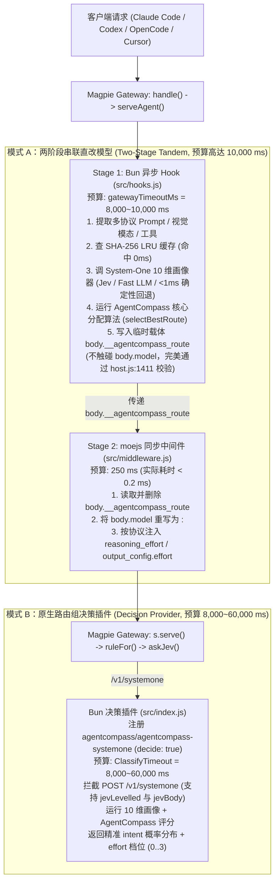

# 为 Magpie 制作纯意图路由插件：源码级调研与新方案设计

> **项目仓库**：`E:\PROJECTS\magpie-agentcompass-router`  
> **核心算法来源**：[**AgentCompass (`akiiwa-games/AgentCompass`)**](https://github.com/akiiwa-games/AgentCompass) (`skills/agent-compass/scripts/route_judge.py` & `allocator.py`)  
> **目标网关**：[**Magpie (`yetone/magpie`)**](https://github.com/yetone/magpie)

---

## 1. 背景与核心痛点分析

### 1.1 Magpie 现有路由机制为什么偏简单？

通过对 Magpie 源码（`internal/gateway/gateway.go`、`internal/gateway/rules.go`、`internal/gateway/classify.go`、`internal/gateway/decide.go`、`internal/middleware/`、`internal/plugin/`）的完整审计，Magpie 目前的路由分为两层，均存在明显局限：

1. **第一层：号池内席位排序策略（Pool / Seat Strategy，`internal/middleware/points.go`）**
   - 内置策略（`smart`、`usage`、`pace`、`order`、`rotate`、`weight`、`free`、`fast`、`cheap`、`drain`）以及插件导出的 `strategies[name](pool, seats, options)`。
   - **局限**：入参只有号池名 `pool` 和候选账号列表 `seats`（含 `used`、`soon`、`pace`、`resting`、`tokens` 等额度状态），**完全拿不到请求的 Prompt 正文、模态、工具列表或任务意图**，只能在模型已经确定后做同池账号排序。

2. **第二层：路由组规则与意图分类器（Routing Group Rules & Classifier，`rules.go` / `classify.go` / `decide.go`）**
   - 路由组（`provider.Group`）通过 `ruleFor` 匹配扁平规则（`Intent`、`Tokens`、`Images`、`Effort`、`Folder`、`Agent`、`Time`）。
   - 当配置了 `Intent` 规则或 `Effort: auto` 时，Magpie 在新对话轮次调用 `classify`（走 `askChat` 聊天分类或 `askJev` `/v1/systemone` 决策接口）：
     - `askChat`（`classify.go:191`）仅把用户在 UI 手写的几条 `Intent` 字符串编号为 `1..N`，让分类模型输出一个整数 `0..N`，另起一个请求输出 `1..4` 的 `effort`。
     - 匹配成功后，仅能**静态映射**到该规则预设的固定模型列表 `Use`。
   - **局限（对比 AgentCompass 核心算法）**：
     - **缺乏多维任务画像（10-Field Task Profile）**：无法同时解耦任务类型（16 类 `work_kind`）、推理深度（`reasoning_depth` 1..4）、生产代码复杂度（`code_complexity` 0..3，区分只读代码审查与实际写代码）、上下文耦合规模（`context_scale` 1..3）、发散度（`divergence` 1..3，区分收敛实现、多假设排查与开放式方案创意）、防幻觉严格度（`hallucination_risk` 1..3）与错误代价（`error_cost` 1..3）。
     - **缺乏模型基因（Model DNA）与 6 维客观能力向量匹配**：无法像 AgentCompass 那样自动根据 `divergence`（Argon `0.96`）、`global_rigor`（Opus `0.98` / Astra `0.82`）、`module_precision`（Sol 6.1 `0.95`）和 GUI 能力（Astra `0.95`）做连续空间匹配。
     - **缺乏能力底线门禁（Ability Floor）与大材小用惩罚（Overqualification Penalty）**：Magpie 的 1D 规则不会计算任务的连续所需能力 `required_ability`，也无法在简单任务（`routine`）上对高价旗舰模型施加 `overqualification` 惩罚，极易出现“杀鸡用牛刀”或“复杂跨模块审计选了轻量模型”的失配。

---

### 1.2 Magpie 插件体系的时间预算瓶颈（源码实测数据）

我们对 Magpie 源码中所有 4 类插件扩展点的运行时环境、超时硬限制与字段修改权限做了逐行核对：

| 扩展点 | 声明位置 | 运行时环境 | 源码超时硬限制 | 能否读取 Prompt | 能否直接改 `body.model` | 源码依据 |
| :--- | :--- | :--- | :--- | :--- | :--- | :--- |
| **1. Seat Strategy** | `magpie.middleware` -> `export const strategies` | `moejs` (Go 进程内同步 JS VM，无网络/异步 I/O) | **20 ms** (`strategyLimit`) | 否（仅 `pool, seats`） | 否 | `internal/middleware/points.go:25` |
| **2. Gateway Middleware** | `magpie.middleware` -> `onRequest(body, ctx)` | `moejs` (Go 进程内同步 JS VM，无网络/异步 I/O) | **250 ms** (`requestLimit`) | **是**（完整 `body`） | **是**（支持改 `body.model` 与 `<model>:<effort>`） | `internal/middleware/middleware.go:39`, `internal/gateway/middleware.go:42-78` |
| **3. Gateway Request Hooks** | `magpie.hooks` -> `async onRequest(body, ctx)` | **Bun 子进程**（支持完整异步网络 `fetch`、子进程、缓存） | 默认 1,000 ms，通过 `gatewayTimeoutMs` **最高可配 10,000 ms (10s)** | **是**（完整 `body`） | **否**（`host.js:1411` 会拦截直接修改 `model`/`tools`/`stream`） | `internal/plugin/host.js:1362, 1411-1415`, `internal/plugin/gateway.go:23` |
| **4. System-One Decision Provider** | `main` -> `decide: true` + `decides: true` (`/v1/systemone`) | **Bun 子进程**（通过 `auth.loader().fetch` 响应） | 默认 **8,000 ms (8s)**，通过 `Settings.ClassifyTimeout` **最高可配 60,000 ms (60s)** | **是**（传入 `state.turn` 等） | 通过返回 `intent` / `level` / `effort` 驱动路由组选模型 | `internal/gateway/decide.go:362`, `internal/gateway/classify.go:42`, `internal/plugin/host.js:1787, 1821` |

---

## 2. 核心突破方案：如何通过插件拿到充裕时间预算并运行 AgentCompass 核心算法？

基于对 `internal/gateway/middleware.go:serveAgent`（第 33–78 行）和 `internal/gateway/decide.go` 的源码追踪，我们设计并在本仓库实现了 **双模式协同架构（Dual-Mode Architecture）**，无需修改 Magpie 任何一行 Go 源码即可突破 20ms/250ms 限制，拿到 **10 秒至 60 秒** 的异步时间预算：



### 2.1 模式 A：两阶段串联架构（`magpie.hooks` [Bun 10s] + `magpie.middleware` [`moejs` 250ms]）

在 `internal/gateway/middleware.go` 的 `serveAgent` 中，Magpie 的执行顺序是严格固定的：
1. **第 39 行**：先执行 `w, body, hooked := gatewayHooks(w, r, from, body)`（即 Bun 进程中的 `magpie.hooks`）。
   - 我们在插件配置中设置 `"gatewayTimeoutMs": 8000`（最高支持 `10000` ms = 10 秒）。
   - 虽然 `internal/plugin/host.js:1411` 禁止 `magpie.hooks` 直接修改 `body.model`、`body.tools`、`body.stream`，但 **`host.js` 完全允许在 `body` 上挂载其他自定义 JSON 属性**！
   - 因此，`src/hooks.js` 在 Bun 充裕的 10 秒异步预算内完成 **System-One 10 维任务画像 + AgentCompass 多维能力分配计算**，并将决策结果写入 `body.__agentcompass_route` 临时载体字段。
2. **第 42–74 行**：紧接着执行 `mw := gwmw.Agent(r.Context(), string(from), agentOf(r), body)`（即 `moejs` 中的 `magpie.middleware`）。
   - `magpie.middleware` 的 `onRequest(body, ctx)` **被 Magpie 官方设计为允许自由重写 `body.model` 和推理强度**（第 52 行 `next, model, err = requestModel(next)` 会重新解析中间件返回的 `model`）。
   - `src/middleware.js` 读取 `body.__agentcompass_route`，**立即删除该临时字段**（确保绝不泄露给上游厂商 API），并将 `body.model` 改写为 `<targetModel>:<targetEffort>`（Magpie 的 `gateway.go:1560` `askedAt()` 原生支持 `<model>:<effort>` 语法，会自动拆解模型名与推理强度）！
   - 若用户未开启 `magpie.hooks` 或异步评分超时，`src/middleware.js` 还会直接在 `moejs` 内运行耗时 `< 0.5 ms` 的确定性孪生画像器 `inferTaskProfile` + `selectBestRoute`，保证 100% 永不掉线。

### 2.2 模式 B：原生 `/v1/systemone` 决策模型插件（`decide: true` / `decides: true`，最高 60 秒预算）

- `src/index.js` 同时实现了 OpenCode / Magpie 标准 Provider 插件接口，通过 `config(cfg)` 注册虚拟决策提供商 `agentcompass`（显示名称 `AgentCompass`，`decide: true`）和决策模型 `agentcompass-systemone`（`decides: true`）。
- 用户通过 `magpie plugin login agentcompass` 登录并在 Magpie 的 **Routing（路由组）** 页面将分类器（Classifier）选为 `agentcompass/agentcompass-systemone`（`AgentCompass System-One Profiler`）后，Magpie 会给予每次分类默认 **8,000 ms**、在设置中最高可调至 **60,000 ms（60 秒）** 的时间预算（`internal/gateway/classify.go:classifyTimeout`）。
- 我们的 `handleSystemOneRequest` 完整兼容了 `internal/gateway/decide.go` 的两阶段协议：
  1. **`jevLevelled` 量表探测请求**（`decide.go:310`，含 `state.kinds` 与 `questions.levels`、`questions.work0..N`）；
  2. **`jevBody` 轮次决策请求**（`decide.go:167`，含 `state.turn` 与 `questions.intent` / `questions.level` / `questions.effort`），将 AgentCompass 算出的 `workKind`、`difficulty`、`targetModel` 和 `targetEffort` 转化为满足 `jevSure (0.6)` 置信度门限的概率分布（含 `"none of these"` 与 `effort.probabilities` `"0".."3"` 字典）返回给 Magpie。

---

## 3. AgentCompass 纯意图路由核心算法移植说明

本插件在 [`src/catalog.js`](../src/catalog.js)、[`src/profiler-core.js`](../src/profiler-core.js) 和 [`src/allocator.js`](../src/allocator.js) 中完整移植了 AgentCompass 的纯意图与能力匹配核心算法（剔除了特定宿主会话耦合，保留全部模型能力、基因与难度门禁数学模型）：

### 3.1 10 维任务画像（System-One Task Profile）

对每个新用户轮次提取以下结构化特征：
- **`work_kind`（16 类标准路由）**：`general_implementation`、`frontend_implementation`、`debug_review`、`complex_build_plan`、`direction_reasoning`、`exploration_analysis`、`research_packet`、`self_contained_code`、`visual_analysis`、`computer_use`、`bounded_bulk_work`、`tool_execution`、`text_in_text_out`、`web_research`、`dot_execution`、`other_or_mixed`。
- **6 个连续难度整数维度**：
  - `reasoning_depth` ($1..4$)：1 = `routine`（日常机械操作），2 = `hard`（标准模块开发/排障/审查），3 = `coupled`（跨模块架构重构/并发死锁审计），4 = `frontier`（形式化数学证明/前沿理论推导）。
  - `code_complexity` ($0..3$)：Worker 实际编写的生产代码复杂度（只读审查/审计强制为 $0$）。
  - `context_scale` ($1..3$)：单模块 ($1$)、多模块耦合 ($2$)、全仓/跨系统 ($3$)。
  - `divergence` ($1..3$)：收敛已知目标 ($1$)、多假设根因排查 ($2$)、开放式创意/新方案设计 ($3$)。
  - `hallucination_risk` ($1..3$)：编译器/单测自验证 ($1$)、混合 ($2$)、无单测兜底的高严格度审查/指标报告 ($3$)。
  - `error_cost` ($1..3$)：低风险只读 ($1$)、常规代码变更 ($2$)、高危生产发布 ($3$)。
- **模态与环境布尔标记**：`needs_visual`、`needs_gui`、`local_only`、`realtime_loop`（Worker 自身处于运行中系统的实时「观察 → 决策 → 动作」闭环；仅由外部 System-One 分类模型或调用方显式指定，确定性 `inferTaskProfile` 绝不通过关键词猜测、缺省恒为 `false`）以及 `interaction_style`（`engineering` / `exploration` / `text_only` / `advisory`）。

### 3.2 连续能力需求（Continuous `taskDemand`）与供给侧努力曲线（`effortAbility`）

1. **任务侧连续能力需求**：
   $$\text{required\_ability} = \text{ability\_floor}[\text{difficulty}] + \text{critical\_headroom} + \text{precision\_headroom} + \text{property\_span} \times \frac{\text{depth}}{4} \times \text{property\_load}$$
   其中难度底线为：`routine: 3.0`、`hard: 3.3`、`coupled: 3.6`、`frontier: 4.2`。
2. **供给侧有效能力**：
   $$\text{effective\_ability}(m, e) = \text{tier}(m) + \Delta\text{ability}(m, e)$$
   低于难度门限 $\text{gate}$ 的 $(m, e)$ 组合直接淘汰；高于 `high` 的努力档位（`xhigh` / `max`）仅在 $\text{required\_ability} > \text{high\_ability}$ 时获得额外能力加分。

### 3.3 三维拟合度融合（Route Fit + 6D Capability Vector + 3D Model DNA）

$$\text{fit} = w_r \cdot \text{route\_fit} + w_v \cdot \text{vector\_fit} + w_s \cdot \text{subjective\_fit}$$

- **`route_fit`**：模型在 16 类 `work_kind` 路由上的先验偏好排序与能力向量回退。
- **`vector_fit`**：模型在 6 个客观能力维度（`reasoning`、`coding`、`exploration`、`anti_hallucination`、`visual`、`gui`）上对任务需求 `profileRequirements` 的满足率 $\min(1, \text{cap}_d / \text{need}_d)$ 加权均值。
- **`subjective_fit`（模型基因 Model DNA）**：
  - `divergence`（发散创意）：`gemini-4-argon-high` ($0.96$) 在开放式方案设计（`divergence = 3`）中胜出；
  - `global_rigor`（全局严密性）：`claude-opus-5-5` ($0.98$) 与 `gpt-6-astra` ($0.82$) 在跨模块审查、死锁排查与架构规划中胜出；
  - `module_precision`（模块精准度）：`gpt-6.1-sol` ($0.95$) 在单模块高内聚代码实现中胜出。

### 3.4 综合得分与大材小用惩罚（Overqualification Penalty）

$$\text{score} = w_{\text{fit}} \cdot \text{fit} + w_{\text{ability}} \cdot \text{ability\_score} + \text{quality\_bonus} - \text{effort\_penalty} - \text{overqualification} - \text{shortfall}$$

- 在常规任务（`minimum_sufficient`）上，当模型有效能力超出 $\text{required\_ability} + \text{saturation\_span}$ 时，按该模型的小时费率 $\text{usd\_per\_hour} \times \text{effort\_burn}$ 施加 `overqualification` 惩罚，从而确保日常批量/简单任务自动落到 `gemini-3.8-flash-high` / `claude-haiku-5-5` / `gpt-6-luna`，而把 `claude-opus-5-5` / `gpt-6-astra` 留给真正需要高阶推理的任务。

---

## 4. Linux 沙盒真实网关实测报告（Real Linux Sandbox E2E Verification）

为验证三层异构运行时（Go Gateway 主进程 + Bun OpenCode 插件宿主 + 嵌入式 `moejs` 引擎）与四条协议边界的真实端到端行为，我们在 WSL2 Linux 沙盒（`Linux 6.18.40.1-microsoft-standard-WSL2 x86_64`，`/run/magpie-sandbox` tmpfs）中编译并运行了真实 Linux `magpie` 守护进程（`magpie serve`）与 Linux `bun` v1.4.2 宿主（完整脚本见 [`test/run-linux-sandbox.sh`](../test/run-linux-sandbox.sh) 与 [`test/linux-sandbox-e2e.mjs`](../test/linux-sandbox-e2e.mjs)，实测产物见 [`docs/linux-sandbox-e2e-report.json`](./linux-sandbox-e2e-report.json)）：

### 4.1 插件注册与扩展点验证（`magpie plugin list`）

```text
✓ added /run/magpie-sandbox/agentcompass
✓ signed in to AgentCompass · its models are agentcompass/<model>
/run/magpie-sandbox/agentcompass  on
  async gateway hook  onRequest
  gateway middleware  onRequest, onAccount · routings agentcompass/agentcompass, agentcompass/agentcompass-pure
  agentcompass (AgentCompass, 1 models)  signed in
```

### 4.2 7 大场景真实网关与插件市场 E2E 测试矩阵

| 场景 | 模式与协议 | 输入请求与测试动作 | 实测结果 | 关键契约验证 | 结果 |
| :--- | :--- | :--- | :--- | :--- | :--- |
| **Scenario 1** | **CLI 插件生命周期** (`magpie plugin add/login/list`) | 安装 `/run/magpie-sandbox/agentcompass` 并登录 `agentcompass` | `agentcompass (AgentCompass, 1 models) signed in` · `routings agentcompass/agentcompass` | 验证 `package.json` 的 `magpie.name`、`magpie.icon` 与 OpenCode 插件加载（排除 `pi.js:49` 的 `pi-package` 冲突） | **PASS** |
| **Scenario 2** | **插件市场与 Web/GUI API** (`magpie web` · `/api/plugins/*`) | `MAGPIE_PLUGIN_MARKET` 加载 `registry.json`；查询 `/api/plugins`、`/api/plugins/page`；切换 `POST /api/plugins/off` 与 `options` | 图标落盘为 `file:a100c6af45032ded.svg`；README `15,217 B`；`Off: true` 时请求保持原模型 `gpt-6-luna` | 完整验证 `market.go`、`github.go` 与 `gui/plugins.go` | **PASS** |
| **Scenario 3** | **Mode A** · `/v1/chat/completions` (`model="auto"`) | 跨 15 个微服务的分布式锁死锁与竞态根因排查（模拟 **1,600 ms** 慢速异步 System-One 评分） | `claude-opus-5-5:max` | 突破 20ms/250ms/1200ms 限制（耗时 `1705 ms`，其中评分 `1601 ms`）；`__agentcompass_route` 载体被 `moejs` 剥离；携带 `User-Agent: Magpie-Router/1.0` | **PASS** |
| **Scenario 4** | **Mode A** · `/v1/chat/completions` & `/v1/responses` | 开放式脑暴 (`divergence=3`)、独立 TS 模块实现 (`/v1/responses`)、JSON 夹具机械批量重命名 (`bounded_bulk_work`) | 脑暴 $\rightarrow$ `gemini-4-argon-high:high`<br/>编码 $\rightarrow$ `gpt-6.1-sol:high`<br/>批量 $\rightarrow$ `gemini-3.8-flash-high:high` | Model DNA (`divergence` / `module_precision`) 与 `routine` 难度 `overqualification` 惩罚同时生效 | **PASS** |
| **Scenario 5** | **Mode A** · `POST /v1/messages` & SSE `stream: true` | Anthropic Messages API 请求与 OpenAI `stream: true` SSE 流式请求 | `/v1/messages` $\rightarrow$ `claude-opus-5-5`<br/>SSE 流式 $\rightarrow$ `gpt-6.1-sol:high` (`[DONE]`) | 验证 Anthropic 协议与 SSE 流式响应完整跑通且不触发 `host.js:1411` 回滚 | **PASS** |
| **Scenario 6** | **Mode A** · 故障注入与优雅降级 | 远程 System-One 评分器返回 `HTTP 500` 及 `2000ms > 300ms` 超时 | `HTTP 500` $\rightarrow$ `claude-opus-5-5`<br/>`Timeout (354ms)` $\rightarrow$ `gemini-4-argon-high` | 远程评分器故障或超时自动中断并无缝回退至本地 `<1ms` `profileTask` 启发式画像 | **PASS** |
| **Scenario 7** | **Mode B** · `/v1/chat/completions` (`model="group/compass-group"`, `classifier=agentcompass/agentcompass-systemone`) | 命中 `direction_reasoning`、命中 `debug_review`、以及未命中任何规则的纯文本翻译请求 | `direction_reasoning` $\rightarrow$ `gemini-4-argon-high:high`<br/>`debug_review` $\rightarrow$ `claude-opus-5-5:xhigh`<br/>`"none of these"` $\rightarrow$ `gpt-6-luna` | `/v1/systemone`（`jevLevelled` + `jevBody`）规则命中、`"none of these"` 兜底回退首模型、以及 `effort=auto` 四档升级全部通过 | **PASS** |

### 4.3 `realtime_loop` 真实 Magpie 验收（Scenario 9–12）

运行环境：WSL2 docker-desktop，静态 Linux 二进制 `magpie-cli-linux-amd64`（官方 release，与 SHA256SUMS 一致）。上游与市场是本地 mock，网关、插件宿主与 `moejs` 是真实的。被测插件提交 `f163e3f`，对比基线 `origin/main` `ab8baba`（第二个真实 Magpie 进程，独立二进制副本与 `data` 目录）。完整记录：[`linux-sandbox-e2e-report.json`](./linux-sandbox-e2e-report.json)（0.1.2891）、[`linux-sandbox-e2e-report-0.1.3196.json`](./linux-sandbox-e2e-report-0.1.3196.json)（0.1.3196）。

```text
BASELINE_SRC=<git archive origin/main 的导出目录> MAGPIE_LINUX_BIN=<magpie-cli-linux-amd64> sh test/run-linux-sandbox.sh
```

0.1.2891（sha256 `ffa0785c…`）原始结果：

```text
[PASS] Scenario 9 (non-realtime vs origin/main): 408 requests over 8 pools, 408 served, 33 distinct routes, 0 diffs; new turns: 48 rows x 8 samples, 0 diffs, 47 rows rerouted on both builds (origin/main flips on 36 rows)
[PASS] Scenario 10 (realtime routing): ideation gemini-4-argon-high:high -> gpt-6-astra:medium; coding gpt-6.1-sol:high -> gpt-6.1-sol:medium; bulk gemini-3.8-flash-high:high -> claude-sonnet-5-5:low; debug claude-opus-5-5:xhigh -> claude-opus-5-5:medium; bundle claude-opus-5-5:xhigh -> claude-opus-5-5:medium; Argon-only pool -> HTTP 404, upstream calls []
[PASS] Scenario 11 (realtime session hold): 20 sessions, 0 reroutes, turns {"a":"claude-opus-5-5:medium","b":"claude-opus-5-5:medium","c":"claude-opus-5-5:medium","d":"claude-opus-5-5:medium","e":"claude-opus-5-5:medium"}; flagless follow-ups {"claude-opus-5-5:medium":14,"claude-opus-5-5:xhigh":6}; explicit false {"realtime":"gpt-6-astra:medium","afterFalse":"gpt-6-astra:high"}; /v1/messages claude-opus-5-5:null -> claude-opus-5-5:null
[PASS] Scenario 12 (pinned slow model): Argon gemini-4-argon-high:high / gemini-4-argon-high:high, opus claude-opus-5-5:xhigh, no pin gpt-6-astra:medium; log: middleware /run/magpie-sandbox/agentcompass [warn]: agentcompass: pinned upstream/gemini-4-argon-high (gemini-4-argon-high@high) responsiveness 0.00 is below the realtime_loop floor 0.5 (too slow per turn for a live loop); kept per explicit user selection
```

0.1.3196（sha256 `b82e24ce…`）四个场景同样通过，路由结果相同；随运行变化的只有 flagless follow-ups（medium 13 / xhigh 7）、explicit false 之后那一轮落在哪个运行时（hold 或重路由），以及 origin/main 翻转行数（35）。

结论与边界：

- **Scenario 9 的比较口径**：首轮、工具循环、短追问、冷会话新一轮、流式、`/v1/responses`、`/v1/messages`、图片输入、`agentcompass:low`、直连模型与路由组，逐请求比较状态码、模型、effort 和完整上游请求体。温会话的新一轮另行采样比较，因为这类请求 hold 还是重路由取决于接到请求的运行时是否持有该会话的记录，`origin/main` 与自身比较也会翻转；判定标准是两个构建合起来不超过这两种结果。
- **实时标记要每轮都带**：Scenario 11 的 flagless follow-ups 只记录、不断言。客户端在后续回合不再发送 `realtime_loop` 时，未见过该会话的运行时会按非实时路由（上面 20 次中有 6 次到 `xhigh`，多次运行观察到 1–11 次，次数随运行变化）。Magpie 的中间件运行时之间不共享存储，因此客户端需每轮带标记，或设置插件选项 `realtime_loop: true`。
- **`/v1/messages` 上看不到 effort**：本场景的上游只有 OpenAI 协议，Magpie 把 `/v1/messages` 转成 chat 后未携带 effort，`origin/main` 同样如此（Scenario 5），所以这条路径只验证了模型选择，没有验证降档。
- **Argon 单独成池时**：候选全部被排除，请求不改写，虚拟模型名由 Magpie 返回 HTTP 404，上游未被调用。

### 4.4 真实上游验收（Scenario 13）

上游换成主机的 Codex 登录，网关、插件与路由配置不变，被测提交 `f163e3f`。

```text
REAL_CODEX_AUTH=<auth.json> BASELINE_SRC=<git archive origin/main 的导出目录> MAGPIE_LINUX_BIN=<magpie-cli-linux-amd64> sh test/run-linux-sandbox.sh
```

0.1.2891 原始结果：

```text
[PASS] Scenario 13 (real upstream): non-realtime gpt-6.1-sol:high (mock gpt-6.1-sol:high) 200 in 11434ms; realtime gpt-6.1-sol:medium (mock gpt-6.1-sol:medium) 200 in 7599ms; /v1/responses gpt-6.1-sol:medium 200; named gpt-6-luna:null 200; flag on the wire: none (plugin off control: observer true, HTTP 200); classifier codex/gpt-6-luna: realtime_loop 12/12, work_kind 12/12
```

0.1.3196 原始结果：

```text
[PASS] Scenario 13 (real upstream): non-realtime gpt-6.1-sol:high (mock gpt-6.1-sol:high) 200 in 10614ms; realtime gpt-6.1-sol:medium (mock gpt-6.1-sol:medium) 200 in 4981ms; /v1/responses gpt-6.1-sol:medium 200; named gpt-6-luna:null 200; flag on the wire: none (plugin off control: observer true, HTTP 200); classifier codex/gpt-6-luna: realtime_loop 12/12, work_kind 11/12
```

| 检查项 | 结果 |
|---|---|
| 真实上游收到的请求不带 `realtime_loop` | 四条请求（非实时、实时、`/v1/responses` 实时、直连点名）均 HTTP 200 且返回文本，观察插件看到的标记都是 `false`；关掉 AgentCompass 的对照请求看到 `true` |
| 路由与 mock 一致 | 非实时都是 `gpt-6.1-sol:high`，实时都是 `gpt-6.1-sol:medium` |
| `openai_compatible` 分类器，12 条成对难例（`codex/gpt-6-luna`） | 三次完整运行，`realtime_loop` 均为 12/12；`work_kind` 为 12/12、12/12、11/12 |

0.1.3196 上唯一的不一致是 `non_realtime_fix_flash_sale_bot_en`：`work_kind` 期望 `debug_review`，返回 `general_implementation`，`realtime_loop` 判对。同一条在另两次运行中判对，所以是模型的波动。作为对照，确定性回退在同一批例子上是 `realtime_loop` 6/12、`work_kind` 7/12。

边界：

- **凭据只放访问令牌**：沙盒副本删掉了 `refresh_token`，也不运行 `magpie accounts import`。刷新令牌会轮换，副本一旦刷新，主机上的 Codex 就会因 `refresh_token_reused` 掉线，而 import 会直接用掉这份登录。副本放在沙盒 tmpfs 上，权限 0600，场景结束即删除并断言已删除。Scenario 13 只验证短时间内的调用，没有覆盖令牌过期后的刷新。
- **"不带字段"的证据范围**：真实上游的入站请求抓不到。证据是 Magpie 发往 provider 之前的 `onProvider` 观察结果（`test/fixtures/route-observer`）、上游返回 200，以及插件关闭时能看到标记的对照。
- **Anthropic 组未运行**：`ANTHROPIC_API_KEY`、`ANTHROPIC_AUTH_TOKEN`、`ANTHROPIC_BASE_URL` 在 Process、User、Machine 三个作用域都未设置，也没有去其他配置文件里找密钥。代码里没有未经测试的 Anthropic 分支。
- **`effort` 为空的那一行**：直连点名 `codex/gpt-6-luna` 不经路由，所以 `gpt-6-luna:null` 是预期结果。
- **未设置 `REAL_CODEX_AUTH` 时**：Scenario 13 记为 `skipped`，其余场景照常运行。

凭据残留检查（只统计命中数，不输出值）：工作区文件、`origin/main..HEAD` 的补丁和测试日志中，令牌全文、令牌前 32 字符、账户 ID 与账户邮箱的命中数均为 0。

### 4.5 `gpt-5.3-codex-spark` 的目录条目

AgentCompass 的 `accounts.json` 与脚本里都没有这个模型，其 Python 实现的规范名就是它自己，responsiveness 用默认值 `[0.52, "default"]`。而 `origin/main` 的 `resolveModelSpec` 因名字含 `codex` 把它解析成 `gpt-6.1-sol`（tier 3.6）。现在它有独立条目：所有数值都是不高于 `gpt-6-luna` 的保守占位，并在 `basis` 中注明；`disabled_by_default: true` 使默认候选池不变，只有候选池点名时才参与路由。其他含 `codex` 的名字仍走原有的家族回退。

这是非实时路由相对 `origin/main` 唯一的有意差异。下表是 2304 个任务画像的逐条比较（`test/realtime-parity.test.mjs` 中的 `Spark: non-realtime differences…`，每条差异必须归入一种原因，否则测试失败）；不点名 Spark 的候选池差异为 0。

| 候选池 | 低于任务门槛 | 被同池模型超过 | 档位不在列表内 | 没有努力曲线 |
|---|---:|---:|---:|---:|
| Spark 单独 | 996 | – | 171 | 99 |
| Spark + `gpt-6-luna` | 960 | 447 | – | – |
| Spark + `gpt-6.1-sol` | 996 | 526 | – | 14 |
| Spark + `gemini-3.8-flash-high` + `claude-sonnet-5-5` | 89 | 4 | – | – |

- **低于任务门槛**：tier 从按 `gpt-6.1-sol` 算的 3.6 降到 3.0，不再满足任务要求，改为同池其他模型或不路由。
- **被同池模型超过**：Spark 仍合格，但能力值变低，同池模型得分更高。
- **档位不在列表内**：`origin/main` 选了 `xhigh`/`max`，Spark 条目只列 `low`/`medium`/`high`。
- **没有努力曲线**：条目没有 ability/burn 曲线，选出的档位随之不同。

---

## 5. 与 [AgentCompass 本体 (`akiiwa-games/AgentCompass`)](https://github.com/akiiwa-games/AgentCompass) 的生态协同

本插件提供 Magpie 网关层面的**单轮纯意图路由（Turn-Level Micro-Router）**。在生产多 Agent 研发工作流中，推荐与 **[AgentCompass 本体 (`https://github.com/akiiwa-games/AgentCompass`)](https://github.com/akiiwa-games/AgentCompass)**、**[Magpie](https://github.com/yetone/magpie)**、**[Cindy](https://github.com/yetone/cindy)** 及 **Paseo** 配合使用：
- **AgentCompass 本体**：负责跨宿主子 Agent 任务拆解与派发（`agentcompass roll`）、结合 Cindy 实时配额的 5h/7d 窗口机会成本精算、2M 累计未压缩上下文强制交接换人、以及 `PreToolUse` 路由门禁；
- **Magpie + `agentcompass` 插件（本仓库）**：负责本地多订阅网关代理、协议转换与单次请求的 10D × (7D+3D) 自动模型/思考档位路由。
