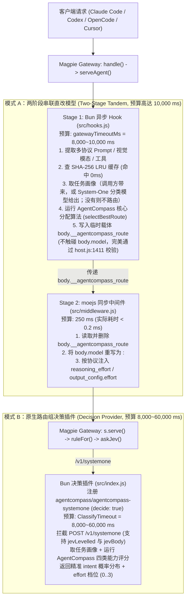

# 为 Magpie 制作纯意图路由插件：源码级调研与新方案设计

> **项目仓库**：[`akiiwa-games/magpie-agentcompass-router`](https://github.com/akiiwa-games/magpie-agentcompass-router)  
> **核心算法来源**：[**AgentCompass (`akiiwa-games/AgentCompass`)**](https://github.com/akiiwa-games/AgentCompass) (`skills/agent-compass/scripts/route_judge.py` & `allocator.py`)  
> **目标网关**：[**Magpie (`yetone/magpie`)**](https://github.com/yetone/magpie)

> **状态（0.2.0）**：引擎已换成 AgentCompass v0.6.0（固定在 `974eb49`）的四类能力打分、配额经济与数据门禁；0.1.x 的 6D/7D 能力向量、3D Model DNA、`realtime_loop`、`EFFORT_CURVES` 等都已被取代并从代码里删除。本文按下面的口径读：
>
> - **现行**：§1（Magpie 的局限，已按 v0.6.0 重写）、§2（双模式架构）、§3（打分，已重写为 v0.6.0）、§4.6（与 AgentCompass 的对拍）、§4.8（0.2.0 的沙盒场景，已在 Magpie 0.1.4022 上运行）、§5。§4.4 里的隔离与凭据边界也仍然适用。
> - **历史记录**：§3.5、§4.1、§4.2、§4.3、§4.4 的运行结果、§4.5、§4.7 是 0.1.x 引擎上某一次（2026 年 10–11 月）运行的原始记录，标题里写明；其中的画像字段、路由结果与命令属于当时的引擎，不随引擎更新，也不是现行行为的说明。现行引擎见 README 的 "How it decides" 与 `docs/RELEASE_NOTES.md` 的 0.2.0。

---

## 1. 背景与核心痛点分析

### 1.1 Magpie 现有路由机制为什么偏简单？

通过对 Magpie 源码（`internal/gateway/gateway.go`、`internal/gateway/rules.go`、`internal/gateway/classify.go`、`internal/gateway/decide.go`、`internal/middleware/`、`internal/plugin/`）的完整审计，Magpie 目前的路由分为两层，均存在明显局限：

1. **第一层：号池内席位排序策略（Pool / Seat Strategy，`internal/middleware/points.go`）**
   - 内置策略（`smart`、`usage`、`pace`、`order`、`rotate`、`weight`、`free`、`fast`、`cheap`、`drain`）以及插件导出的 `strategies[name](pool, seats, options)`。
   - **局限**：入参只有号池名 `pool` 和候选账号列表 `seats`（含 `used`、`soon`、`pace`、`resting`、`tokens` 等额度状态），**完全拿不到请求的 Prompt 正文、模态、工具列表或任务意图**，只能在模型已经确定后做同池账号排序。

2. **第二层：路由组规则与意图分类器（Routing Group Rules & Classifier，`rules.go` / `classify.go` / `decide.go`）**
   - 路由组（`provider.Group`）通过 `ruleFor` 匹配扁平规则（`Intent`、`Tokens`、`Images`、`Effort`、`Folder`、`Agent`、`Time`）。
   - 当配置了 `Intent` 规则或 `Effort: auto` 时，Magpie 在新对话轮次调用 `classify`（走 `askChat` 聊天分类或 `askJev` `/v1/systemone` 决策接口）：
     - `askChat`（`classify.go:191`）仅把用户在 UI 手写的几条 `Intent` 字符串编号为 `1..N`，让分类模型输出一个整数 `0..N`，另起一个请求输出 `1..4` 的 `effort`。
     - 匹配成功后，仅能**静态映射**到该规则预设的固定模型列表 `Use`。
   - **局限（对比 AgentCompass 核心算法）**：
     - **缺乏结构化任务画像（Task Profile）**：无法同时解耦任务类型（16 类 `work_kind`）、推理深度（`reasoning_depth` 1..4）、生产代码复杂度与读写方式（`code_complexity` 0..3、`access`：区分只读代码审查与实际写代码）、对四类能力的需求等级（`axis_demand`：`divergence`、`coding`、`aesthetics`、`tool_operation`，各 0..3 级）、模态与环境需求（`needs_visual`、`needs_gui`、`local_only`）、预计时长与紧迫度（`expected_hours`、`urgency`、`wants_fast`）。
     - **缺乏按类别的能力数据与数据门禁（Rule B）**：无法像 AgentCompass 那样用每个模型在四类能力上、按努力档位给出的有出处评分（以面板标准差计）与任务的需求等级做拟合；需求的类别没有数据、计费账号没有标价、图片输入未知、该档位没有 Time/Task 时，该 `<模型, 档位>` 不进自动路由，而不是猜一个分数。
     - **缺乏配额经济（Quota Economy）**：Magpie 的 1D 规则看不到各账号的订阅窗口：5 小时窗口决定任务能否启动，24 小时及以上的窗口按机会成本定价，净分 `N = fit + continuity + boost − quota_cost` 才能在“把贵的旗舰留给真正需要的任务”与“快用完的额度别再开新活”之间取舍；没有这一层，极易出现“杀鸡用牛刀”或“复杂跨模块审计选了轻量模型”的失配。

---

### 1.2 Magpie 插件体系的时间预算瓶颈（源码实测数据）

我们对 Magpie 源码中所有 4 类插件扩展点的运行时环境、超时硬限制与字段修改权限做了逐行核对：

| 扩展点 | 声明位置 | 运行时环境 | 源码超时硬限制 | 能否读取 Prompt | 能否直接改 `body.model` | 源码依据 |
| :--- | :--- | :--- | :--- | :--- | :--- | :--- |
| **1. Seat Strategy** | `magpie.middleware` -> `export const strategies` | `moejs` (Go 进程内同步 JS VM，无网络/异步 I/O) | **20 ms** (`strategyLimit`) | 否（仅 `pool, seats`） | 否 | `internal/middleware/points.go:25` |
| **2. Gateway Middleware** | `magpie.middleware` -> `onRequest(body, ctx)` | `moejs` (Go 进程内同步 JS VM，无网络/异步 I/O) | **250 ms** (`requestLimit`) | **是**（完整 `body`） | **是**（支持改 `body.model` 与 `<model>:<effort>`） | `internal/middleware/middleware.go:39`, `internal/gateway/middleware.go:42-78` |
| **3. Gateway Request Hooks** | `magpie.hooks` -> `async onRequest(body, ctx)` | **Bun 子进程**（支持完整异步网络 `fetch`、子进程、缓存） | 默认 1,000 ms，通过 `gatewayTimeoutMs` **最高可配 10,000 ms (10s)** | **是**（完整 `body`） | **否**（`host.js:1411` 会拦截直接修改 `model`/`tools`/`stream`） | `internal/plugin/host.js:1362, 1411-1415`, `internal/plugin/gateway.go:23` |
| **4. System-One Decision Provider** | `main` -> `decide: true` + `decides: true` (`/v1/systemone`) | **Bun 子进程**（通过 `auth.loader().fetch` 响应） | 默认 **8,000 ms (8s)**，通过 `Settings.ClassifyTimeout` **最高可配 60,000 ms (60s)** | **是**（传入 `state.turn` 等） | 通过返回 `intent` / `level` / `effort` 驱动路由组选模型 | `internal/gateway/decide.go:362`, `internal/gateway/classify.go:42`, `internal/plugin/host.js:1787, 1821` |

---

## 2. 核心突破方案：如何通过插件拿到充裕时间预算并运行 AgentCompass 核心算法？

基于对 `internal/gateway/middleware.go:serveAgent`（第 33–78 行）和 `internal/gateway/decide.go` 的源码追踪，我们设计并在本仓库实现了 **双模式协同架构（Dual-Mode Architecture）**，无需修改 Magpie 任何一行 Go 源码即可突破 20ms/250ms 限制，拿到 **10 秒至 60 秒** 的异步时间预算：



### 2.1 模式 A：两阶段串联架构（`magpie.hooks` [Bun 10s] + `magpie.middleware` [`moejs` 250ms]）

> **现状（0.2.0）**：包的 `package.json` 不声明 `magpie.hooks`，随包只发 `magpie.middleware`；模式 A 的画像随请求带来（`body.profile`），`moejs` 没有网络，问不了分类模型（README 的 "Known limitations"）。下面两阶段串联描述的是 `src/hooks.js` 被宿主启用时的行为，该文件仍在 `src/` 里，并与中间件、决策 provider 路由同一画像得到同一结果（`test/router.test.mjs`）。

在 `internal/gateway/middleware.go` 的 `serveAgent` 中，Magpie 的执行顺序是严格固定的：
1. **第 39 行**：先执行 `w, body, hooked := gatewayHooks(w, r, from, body)`（即 Bun 进程中的 `magpie.hooks`）。
   - 我们在插件配置中设置 `"gatewayTimeoutMs": 8000`（最高支持 `10000` ms = 10 秒）。
   - 虽然 `internal/plugin/host.js:1411` 禁止 `magpie.hooks` 直接修改 `body.model`、`body.tools`、`body.stream`，但 **`host.js` 完全允许在 `body` 上挂载其他自定义 JSON 属性**！
   - 因此，`src/hooks.js` 在 Bun 充裕的 10 秒异步预算内完成 **取任务画像（调用方带来或分类模型给出）+ AgentCompass 四类能力评分与配额经济计算**，并将决策结果写入 `body.__agentcompass_route` 临时载体字段。
2. **第 42–74 行**：紧接着执行 `mw := gwmw.Agent(r.Context(), string(from), agentOf(r), body)`（即 `moejs` 中的 `magpie.middleware`）。
   - `magpie.middleware` 的 `onRequest(body, ctx)` **被 Magpie 官方设计为允许自由重写 `body.model` 和推理强度**（第 52 行 `next, model, err = requestModel(next)` 会重新解析中间件返回的 `model`）。
   - `src/middleware.js` 读取 `body.__agentcompass_route`，**立即删除该临时字段**（确保绝不泄露给上游厂商 API），并将 `body.model` 改写为 `<targetModel>:<targetEffort>`（Magpie 的 `gateway.go:1560` `askedAt()` 原生支持 `<model>:<effort>` 语法，会自动拆解模型名与推理强度）！
   - 若用户未开启 `magpie.hooks` 或异步评分失败，且调用方也没有传入画像，`src/middleware.js` 不做路由：原样转发客户端请求的模型，并写明"未路由：分类不可用"（原有的关键词孪生画像器 `inferTaskProfile` 已删除，见 README）。

### 2.2 模式 B：原生 `/v1/systemone` 决策模型插件（`decide: true` / `decides: true`，最高 60 秒预算）

- `src/index.js` 同时实现了 OpenCode / Magpie 标准 Provider 插件接口，通过 `config(cfg)` 注册虚拟决策提供商 `agentcompass`（显示名称 `AgentCompass`，`decide: true`）和决策模型 `agentcompass-systemone`（`decides: true`）。
- 用户通过 `magpie plugin login agentcompass` 登录并在 Magpie 的 **Routing（路由组）** 页面将分类器（Classifier）选为 `agentcompass/agentcompass-systemone`（`AgentCompass System-One Profiler`）后，Magpie 会给予每次分类默认 **8,000 ms**、在设置中最高可调至 **60,000 ms（60 秒）** 的时间预算（`internal/gateway/classify.go:classifyTimeout`）。
- 我们的 `handleSystemOneRequest` 完整兼容了 `internal/gateway/decide.go` 的两阶段协议：
  1. **`jevLevelled` 量表探测请求**（`decide.go:310`，含 `state.kinds` 与 `questions.levels`、`questions.work0..N`）；
  2. **`jevBody` 轮次决策请求**（`decide.go:167`，含 `state.turn` 与 `questions.intent` / `questions.level` / `questions.effort`），将 AgentCompass 算出的 `workKind`、`difficulty`、`targetModel` 和 `targetEffort` 转化为满足 `jevSure (0.6)` 置信度门限的概率分布（含 `"none of these"` 与 `effort.probabilities` `"0".."3"` 字典）返回给 Magpie。

---

## 3. AgentCompass v0.6.0 打分移植说明

评分逐模块移植自 AgentCompass（固定在 `test/fixtures/agentcompass-pin.json` 里的提交 `974eb49`，数据取自该提交，不读任何工作区）：`src/axis-scores.js`、`candidate-eval.js`、`candidate-ranking.js`、`quota-economy.js`、`quota-pools.js`、`task-intake.js`、`fleet.js`、`plans.js`、`user-scores.js`，数据在 `src/reference-data.js` 与 `src/catalog.js` 的生成段。移植是否一致由 §4.6 的对拍判定：两边有差异时，改的是移植，不是对拍。

### 3.1 任务画像（Task Profile）

画像只来自分类模型或调用方（`body.profile`）；`src/` 里没有任何一处读任务的字词（`test/no-hardcode.test.mjs` 把这一点锁住）。字段：

- **`work_kind`**（16 类标准路由）：`general_implementation`、`frontend_implementation`、`debug_review`、`complex_build_plan`、`direction_reasoning`、`exploration_analysis`、`research_packet`、`self_contained_code`、`visual_analysis`、`computer_use`、`bounded_bulk_work`、`tool_execution`、`text_in_text_out`、`web_research`、`dot_execution`、`other_or_mixed`。
- **难度**：`reasoning_depth`（1..4：日常机械操作、标准模块开发/排障/审查、跨模块架构重构/并发死锁审计、形式化证明/前沿推导）、`code_complexity`（0..3：Worker 实际写的生产代码；只读审查为 0）。
- **读写方式**：`access`（`write` / `read-only`）与 `read_only_review`。
- **对四类能力的需求**：`axis_demand`，`divergence`（发散创意）、`coding`（写代码）、`aesthetics`（审美/视觉设计）、`tool_operation`（操作工具与界面）各 0..3 级。
- **模态与环境**：`needs_visual`、`needs_gui`、`local_only`、`interaction_style`。
- **时间**：`expected_hours`、`hours_confidence`、`urgency`、`wants_fast`；以及 `multi_task`、`task_count`。

0.1.x 的 `context_scale`、`hallucination_risk`、`error_cost`、`divergence`（作为单独字段）与 `realtime_loop` 不再存在；旧形状的画像会被拒绝（`invalid_caller_profile`），不会被修补。

### 3.2 四类能力的拟合度（fit）

每个 `<模型, 档位>` 行在四个类别上各有一个评分（以面板标准差计，每个分数带出处：维护者数据、实测或估计）。任务对某类别的需求等级定出目标（等级 1 和 2 取 `t1`，等级 3 取该类别的上限），拟合在上限处封顶：

$$\text{fit} = \frac{\sum_a w_a \cdot \big(\min(z_a, \text{cap}_a) - t1_a\big)}{\sum_a w_a}$$

其中 $a$ 取任务有需求的类别，$w_a$ 为需求等级。`tool_operation` 按分项读取：2 级要求响应速度，3 级另外要求图片输入。没有按模型分别给出分数的家族名和未知名（如 `claude-opus-9`）不参与自动路由，只在点名时派发。

### 3.3 数据门禁（Rule B）

需求的类别没有数据、计费账号没有标价（`usd_per_hour` 无出处）、3 级需求下图片输入未知、该档位没有 Time/Task、或窗口容量未知，该行退出自动路由，并在 `warnings` 里写明数据错误；点名该模型仍可派发。提供方有自己的派发档位表、而表里没有列出的裸模型名（例如候选池 `codex/claude-opus-5-5`）不提供任何档位，该行不带档位地参与路由（`account_fleet.dispatch_allowed_efforts`：降档不会落在未经验证的档位上）；没有表的网关则按数据里计过时的档位展开。

### 3.4 配额经济与排序

- **净分**：$N = \text{fit} + \text{continuity} + \text{boost} - \text{quota\_cost}$。
- **窗口**：5 小时窗口只做可行性闸门（任务要放得进窗口，留 `safety_margin_pct = 5%` 的余量），不定价；24 小时及以上的窗口按机会成本定价（`quota_cost`），窗口确认耗尽或低于启动下限的行被排除。额度剩得越多，成本从不升高。
- **容量**：窗口的美元容量来自账号的 `plan`（固定的 `plan-templates.json` 与社区数据）；`plan` 未上报或不认识时容量未知，账号退出自动路由，直到上报。
- **排序键**：净分，然后依次是等待小时、完成小时、美元、类别级别。
- **没有**：能力下限（ability floor）、过度合格惩罚（overqualification）、实时降档。档位由拟合与配额经济共同选出。

### 3.5 历史：0.1.x 的方案（已被取代）

> 这一节是 0.1.x 当时的设计记录，现已从代码里删除，不描述现行行为。

0.1.x 用 10 维画像（`reasoning_depth`、`code_complexity`、`context_scale`、`divergence`、`hallucination_risk`、`error_cost` 六个连续整数，加 `needs_visual`、`needs_gui`、`local_only`、`realtime_loop`）算任务侧连续能力需求 `required_ability = ability_floor[difficulty] + critical_headroom + precision_headroom + property_span × depth/4 × property_load`（难度底线 `routine 3.0`、`hard 3.3`、`coupled 3.6`、`frontier 4.2`），与供给侧 `effective_ability = tier + Δability(m, e)` 比较，低于难度门限的组合淘汰；再把路由先验 `route_fit`、6 维客观能力向量 `vector_fit`（`reasoning`、`coding`、`exploration`、`anti_hallucination`、`visual`、`gui`）与 3 维模型基因 `subjective_fit`（`divergence`、`global_rigor`、`module_precision`）加权融合；综合得分 $\text{score} = w_{fit}\cdot\text{fit} + w_{ability}\cdot\text{ability\_score} + \text{quality\_bonus} - \text{effort\_penalty} - \text{overqualification} - \text{shortfall}$，并在日常任务上按小时费率对过度合格的旗舰施加 `overqualification` 惩罚。`realtime_loop` 为真时排除响应慢的档位并逐档降级。AgentCompass v0.6.0 用四类能力的 `axis_demand` 与配额经济替换了整套机制（见 `docs/RELEASE_NOTES.md` 的 0.2.0）。
---

## 4. Linux 沙盒真实网关实测报告（Real Linux Sandbox E2E Verification）

> **读法**：§4.1、§4.2、§4.3、§4.4 的运行结果、§4.5、§4.7 是 0.1.x 引擎上的运行记录（2026 年 10–11 月），标题标了“历史记录”；其中的路由结果、画像字段与命令（含已删除的 `BASELINE_SRC`）是当时的，保持原样。现行的对拍见 §4.6，现行的沙盒场景见 §4.8。`docs/linux-sandbox-e2e-report*.json` 同样是那几次运行的产物，不随引擎更新。

为验证三层异构运行时（Go Gateway 主进程 + Bun OpenCode 插件宿主 + 嵌入式 `moejs` 引擎）与四条协议边界的真实端到端行为，我们在 WSL2 Linux 沙盒（`Linux 6.18.40.1-microsoft-standard-WSL2 x86_64`，`/run/magpie-sandbox` tmpfs）中编译并运行了真实 Linux `magpie` 守护进程（`magpie serve`）与 Linux `bun` v1.4.2 宿主（完整脚本见 [`test/run-linux-sandbox.sh`](../test/run-linux-sandbox.sh) 与 [`test/linux-sandbox-e2e.mjs`](../test/linux-sandbox-e2e.mjs)，实测产物见 [`docs/linux-sandbox-e2e-report.json`](./linux-sandbox-e2e-report.json)）：

### 4.1 插件注册与扩展点验证（`magpie plugin list`）（0.1.x 历史记录：当时的包还带 `magpie.hooks`，现在只有中间件）

```text
✓ added /run/magpie-sandbox/agentcompass
✓ signed in to AgentCompass · its models are agentcompass/<model>
/run/magpie-sandbox/agentcompass  on
  async gateway hook  onRequest
  gateway middleware  onRequest, onAccount · routings agentcompass/agentcompass, agentcompass/agentcompass-pure
  agentcompass (AgentCompass, 1 models)  signed in
```

### 4.2 7 大场景真实网关与插件市场 E2E 测试矩阵（0.1.x 历史记录）

| 场景 | 模式与协议 | 输入请求与测试动作 | 实测结果 | 关键契约验证 | 结果 |
| :--- | :--- | :--- | :--- | :--- | :--- |
| **Scenario 1** | **CLI 插件生命周期** (`magpie plugin add/login/list`) | 安装 `/run/magpie-sandbox/agentcompass` 并登录 `agentcompass` | `agentcompass (AgentCompass, 1 models) signed in` · `routings agentcompass/agentcompass` | 验证 `package.json` 的 `magpie.name`、`magpie.icon` 与 OpenCode 插件加载（排除 `pi.js:49` 的 `pi-package` 冲突） | **PASS** |
| **Scenario 2** | **插件市场与 Web/GUI API** (`magpie web` · `/api/plugins/*`) | `MAGPIE_PLUGIN_MARKET` 加载 `registry.json`；查询 `/api/plugins`、`/api/plugins/page`；切换 `POST /api/plugins/off` 与 `options` | 图标落盘为 `file:a100c6af45032ded.svg`；README `15,217 B`；`Off: true` 时请求保持原模型 `gpt-6-luna` | 完整验证 `market.go`、`github.go` 与 `gui/plugins.go` | **PASS** |
| **Scenario 3** | **Mode A** · `/v1/chat/completions` (`model="auto"`) | 跨 15 个微服务的分布式锁死锁与竞态根因排查（模拟 **1,600 ms** 慢速异步 System-One 评分） | `claude-opus-5-5:max` | 突破 20ms/250ms/1200ms 限制（耗时 `1705 ms`，其中评分 `1601 ms`）；`__agentcompass_route` 载体被 `moejs` 剥离；携带 `User-Agent: Magpie-Router/1.0` | **PASS** |
| **Scenario 4** | **Mode A** · `/v1/chat/completions` & `/v1/responses` | 开放式脑暴 (`divergence=3`)、独立 TS 模块实现 (`/v1/responses`)、JSON 夹具机械批量重命名 (`bounded_bulk_work`) | 脑暴 $\rightarrow$ `gemini-4-argon-high:high`<br/>编码 $\rightarrow$ `gpt-6.1-sol:high`<br/>批量 $\rightarrow$ `gemini-3.8-flash-high:high` | Model DNA (`divergence` / `module_precision`) 与 `routine` 难度 `overqualification` 惩罚同时生效 | **PASS** |
| **Scenario 5** | **Mode A** · `POST /v1/messages` & SSE `stream: true` | Anthropic Messages API 请求与 OpenAI `stream: true` SSE 流式请求 | `/v1/messages` $\rightarrow$ `claude-opus-5-5`<br/>SSE 流式 $\rightarrow$ `gpt-6.1-sol:high` (`[DONE]`) | 验证 Anthropic 协议与 SSE 流式响应完整跑通且不触发 `host.js:1411` 回滚 | **PASS** |
| **Scenario 6** | **Mode A** · 故障注入与优雅降级 | 远程 System-One 评分器返回 `HTTP 500` 及 `2000ms > 300ms` 超时 | `HTTP 500` $\rightarrow$ `claude-opus-5-5`<br/>`Timeout (354ms)` $\rightarrow$ `gemini-4-argon-high` | 远程评分器故障或超时自动中断并无缝回退至本地 `<1ms` `profileTask` 启发式画像 | **PASS** |
| **Scenario 7** | **Mode B** · `/v1/chat/completions` (`model="group/compass-group"`, `classifier=agentcompass/agentcompass-systemone`) | 命中 `direction_reasoning`、命中 `debug_review`、以及未命中任何规则的纯文本翻译请求 | `direction_reasoning` $\rightarrow$ `gemini-4-argon-high:high`<br/>`debug_review` $\rightarrow$ `claude-opus-5-5:xhigh`<br/>`"none of these"` $\rightarrow$ `gpt-6-luna` | `/v1/systemone`（`jevLevelled` + `jevBody`）规则命中、`"none of these"` 兜底回退首模型、以及 `effort=auto` 四档升级全部通过 | **PASS** |

### 4.3 `realtime_loop` 真实 Magpie 验收（Scenario 9–12）（0.1.x 历史记录：`realtime_loop` 已在 v0.6.0 删除）

运行环境：WSL2 docker-desktop，静态 Linux 二进制 `magpie-cli-linux-amd64`（官方 release，与 SHA256SUMS 一致）。上游与市场是本地 mock，网关、插件宿主与 `moejs` 是真实的。被测插件提交 `c5d59e8`，对比基线 `origin/main` `ab8baba`（第二个真实 Magpie 进程，独立二进制副本与 `data` 目录）。完整记录：[`linux-sandbox-e2e-report.json`](./linux-sandbox-e2e-report.json)（0.1.2891）、[`linux-sandbox-e2e-report-0.1.3196.json`](./linux-sandbox-e2e-report-0.1.3196.json)（0.1.3196）。

```text
BASELINE_SRC=<git archive origin/main 的导出目录> MAGPIE_LINUX_BIN=<magpie-cli-linux-amd64> sh test/run-linux-sandbox.sh
```

0.1.2891（sha256 `ffa0785c…`）原始结果，取自带真实凭据、在隔离 namespace 内以 `nobody`（`uid=65534`）运行的那次：

```text
[PASS] Scenario 9 (non-realtime vs origin/main): 408 requests over 8 pools, 408 served, 33 distinct routes, 0 diffs; new turns: 48 rows x 8 samples, 0 diffs, 47 rows rerouted on both builds (origin/main flips on 36 rows)
[PASS] Scenario 10 (realtime routing): ideation gemini-4-argon-high:high -> gpt-6-astra:medium; coding gpt-6.1-sol:high -> gpt-6.1-sol:medium; bulk gemini-3.8-flash-high:high -> claude-sonnet-5-5:low; debug claude-opus-5-5:xhigh -> claude-opus-5-5:medium; bundle claude-opus-5-5:xhigh -> claude-opus-5-5:medium; Argon-only pool -> HTTP 404, upstream calls []
[PASS] Scenario 11 (realtime session hold): 20 sessions, 0 reroutes, turns {"a":"claude-opus-5-5:medium","b":"claude-opus-5-5:medium","c":"claude-opus-5-5:medium","d":"claude-opus-5-5:medium","e":"claude-opus-5-5:medium"}; flagless follow-ups {"claude-opus-5-5:medium":17,"claude-opus-5-5:xhigh":3}; explicit false {"realtime":"gpt-6-astra:medium","afterFalse":"gemini-4-argon-high:high"}; /v1/messages claude-opus-5-5:null -> claude-opus-5-5:null
[PASS] Scenario 12 (pinned slow model): Argon gemini-4-argon-high:high / gemini-4-argon-high:high, opus claude-opus-5-5:xhigh, no pin gpt-6-astra:medium; log: middleware /run/magpie-sandbox/agentcompass [warn]: agentcompass: pinned upstream/gemini-4-argon-high (gemini-4-argon-high@high) responsiveness 0.00 is below the realtime_loop floor 0.5 (too slow per turn for a live loop); kept per explicit user selection
```

0.1.3196（sha256 `b82e24ce…`）四个场景同样通过，路由结果相同；随运行变化的只有 flagless follow-ups（medium 16 / xhigh 4）、explicit false 之后那一轮落在哪个运行时（hold 或重路由），以及 origin/main 翻转行数（36）。

不带凭据的路径在 0.1.2891 上也单独跑了一次：开头的沙盒回归自检（C1 假令牌崩溃 0 转储、C2 `nobody`/`mount.drvfs`/`umount`/`core_pattern`/X11 拒绝、C5 带空格路径哈希校验）通过，Scenario 1–12 全部 PASS，Scenario 13 为 `[SKIP] Scenario 13 (real upstream): no REAL_*_AUTH set`。

结论与边界：

- **Scenario 9 的比较口径**：首轮、工具循环、短追问、冷会话新一轮、流式、`/v1/responses`、`/v1/messages`、图片输入、`agentcompass:low`、直连模型与路由组，逐请求比较状态码、模型、effort 和完整上游请求体。温会话的新一轮另行采样比较，因为这类请求 hold 还是重路由取决于接到请求的运行时是否持有该会话的记录，`origin/main` 与自身比较也会翻转；判定标准是两个构建合起来不超过这两种结果。
- **实时标记要每轮都带**：Scenario 11 的 flagless follow-ups 只记录、不断言。客户端在后续回合不再发送 `realtime_loop` 时，未见过该会话的运行时会按非实时路由（上面 20 次中有 3–4 次到 `xhigh`，多次运行观察到 1–11 次，次数随运行变化）。Magpie 的中间件运行时之间不共享存储，因此客户端需每轮带标记，或设置插件选项 `realtime_loop: true`。
- **`/v1/messages` 上看不到 effort**：本场景的上游只有 OpenAI 协议，Magpie 把 `/v1/messages` 转成 chat 后未携带 effort，`origin/main` 同样如此（Scenario 5），所以这条路径只验证了模型选择，没有验证降档。
- **Argon 单独成池时**：候选全部被排除，请求不改写，虚拟模型名由 Magpie 返回 HTTP 404，上游未被调用。

### 4.4 真实上游验收（Scenario 13）（运行结果为 0.1.x 历史记录；凭据与隔离的边界仍适用）

一个 Magpie 实例同时登录 Codex、Claude 订阅和 Grok 三个账户，每个账户各跑一组：非实时、实时、`/v1/responses` 实时、直连点名、关掉插件的对照，以及 12 条成对难例。被测提交 `c5d59e8`。

```text
REAL_CODEX_AUTH=<auth.json> REAL_CLAUDE_AUTH=<.credentials.json> REAL_GROK_AUTH=<auth.json> BASELINE_SRC=<git archive origin/main 的导出目录> MAGPIE_LINUX_BIN=<magpie-cli-linux-amd64> sh test/run-linux-sandbox.sh
```

0.1.2891 原始结果：

```text
[PASS] Sandbox regression checks: C1 fake-token crash dumps=0, C2 nobody/mount.drvfs/umount/core_pattern/X11 refused, C5 path-with-spaces hash verified
[Sign-in copy] codex: kept tokens.access_token; dropped auth_mode, OPENAI_API_KEY, tokens.id_token, tokens.refresh_token, tokens.account_id, last_refresh
[Sign-in copy] claude: kept claudeAiOauth.accessToken, claudeAiOauth.scopes; dropped claudeAiOauth.refreshToken, claudeAiOauth.expiresAt, claudeAiOauth.refreshTokenExpiresAt, claudeAiOauth.subscriptionType, claudeAiOauth.subscriptionTypeSource, claudeAiOauth.rateLimitTier
[Sign-in copy] grok: kept <account>.key; dropped <account>.auth_mode, <account>.create_time, <account>.user_id, <account>.email, <account>.first_name, <account>.profile_image_asset_id, <account>.principal_type, <account>.principal_id, <account>.team_id, <account>.team_zero_data_retention, <account>.coding_data_retention_opt_out, <account>.coding_data_team, <account>.refresh_token, <account>.expires_at, <account>.oidc_issuer, <account>.oidc_client_id
[Host isolation] control, outside the namespace: 3 sign-in files readable, Windows program on tmpfs runs
[Host isolation] inside the namespace (uid=65534, core=1:1): sign-in files gone, host drives empty, no host mounts, X11 masked, cmd.exe refused, Windows program on tmpfs refused, mount.drvfs refused, umount /run/WSL refused, core_pattern refused
[PASS] Scenario 13 (real upstream, codex): non-realtime gpt-6.1-sol:high (mock gpt-6.1-sol:high) 200 in 8314ms; realtime gpt-6.1-sol:medium (mock gpt-6.1-sol:medium) 200 in 7164ms; /v1/responses gpt-6.1-sol:medium 200; named gpt-6-luna:null 200; flag on the wire: none (plugin off control: observer true, HTTP 200); classifier codex/gpt-6-luna: realtime_loop 12/12, work_kind 11/12
[PASS] Scenario 13 (real upstream, claude): non-realtime claude-opus-5-5:medium (mock claude-opus-5-5:medium) 200 in 7546ms; realtime claude-sonnet-5-5:medium (mock claude-sonnet-5-5:medium) 200 in 30518ms; /v1/responses claude-sonnet-5-5:medium 200; named claude-haiku-5-5:null 200; flag on the wire: none (plugin off control: observer true, HTTP 200); classifier claude/claude-haiku-5-5: realtime_loop 12/12, work_kind 11/12
[PASS] Scenario 13 (real upstream, grok): non-realtime grok-4.7:high (mock grok-4.7:high) 200 in 33948ms; realtime grok-4.7:low (mock grok-4.7:low) 200 in 15508ms; /v1/responses grok-4.7:low 200; named grok-4.7-build-fast:null 200; flag on the wire: none (plugin off control: observer true, HTTP 200); classifier grok/grok-4.7-build-fast: realtime_loop 12/12, work_kind 11/12
[PASS] Scenario 13 (real upstream): accounts codex, claude, grok; isolation {"signInFilesVisible":false,"hostDrivesReadable":false,"hostMountsLeft":0,"x11SocketVisible":false,"cmdExe":"refused","windowsProgramOnTmpfs":"refused","pidNamespace":true,"uid":65534,"coreLimit":"1:1","mountDrvfs":"refused","umountWsl":"refused","writeCorePattern":"refused"}
[PASS] Crash dump check: 0 dumps in %TEMP%\wsl-crashes
[PASS] Host sign-in files: hashes the same before and after the run (3 files)
[Cleanup] %TEMP%\wsl-crashes dumps from this run removed: 0
```

0.1.3196 原始结果（`[Sign-in copy]`、`[Host isolation]`、`[PASS] Crash dump check` 和 `[Cleanup]` 行相同）：

```text
[PASS] Scenario 13 (real upstream, codex): non-realtime gpt-6.1-sol:high (mock gpt-6.1-sol:high) 200 in 9852ms; realtime gpt-6.1-sol:medium (mock gpt-6.1-sol:medium) 200 in 5937ms; /v1/responses gpt-6.1-sol:medium 200; named gpt-6-luna:null 200; flag on the wire: none (plugin off control: observer true, HTTP 200); classifier codex/gpt-6-luna: realtime_loop 12/12, work_kind 10/12
[PASS] Scenario 13 (real upstream, claude): non-realtime claude-opus-5-5:medium (mock claude-opus-5-5:medium) 200 in 8881ms; realtime claude-sonnet-5-5:medium (mock claude-sonnet-5-5:medium) 200 in 26653ms; /v1/responses claude-sonnet-5-5:medium 200; named claude-haiku-5-5:null 200; flag on the wire: none (plugin off control: observer true, HTTP 200); classifier claude/claude-haiku-5-5: realtime_loop 12/12, work_kind 10/12
[PASS] Scenario 13 (real upstream, grok): non-realtime grok-4.7:high (mock grok-4.7:high) 200 in 21266ms; realtime grok-4.7:low (mock grok-4.7:low) 200 in 16891ms; /v1/responses grok-4.7:low 200; named grok-4.7-build-fast:null 200; flag on the wire: none (plugin off control: observer true, HTTP 200); classifier grok/grok-4.7-build-fast: realtime_loop 12/12, work_kind 11/12
[PASS] Scenario 13 (real upstream): accounts codex, claude, grok; isolation {"signInFilesVisible":false,"hostDrivesReadable":false,"hostMountsLeft":0,"x11SocketVisible":false,"cmdExe":"refused","windowsProgramOnTmpfs":"refused","pidNamespace":true,"uid":65534,"coreLimit":"1:1","mountDrvfs":"refused","umountWsl":"refused","writeCorePattern":"refused"}
[PASS] Crash dump check: 0 dumps in %TEMP%\wsl-crashes
[PASS] Host sign-in files: hashes the same before and after the run (3 files)
[Cleanup] %TEMP%\wsl-crashes dumps from this run removed: 0
```

三个账户在两个版本上都能作为上游，没有 `not_supported`：

| 账户 | Magpie 的接入方式 | 沙盒里的准备 |
|---|---|---|
| Codex | 读 `~/.codex/auth.json`，直接请求 `chatgpt.com` | 无 |
| Claude 订阅 | 读 `~/.claude/.credentials.json`，通过 Claude Code 程序发请求 | `magpie claude-code install` 下载 Anthropic 的构建（校验 SHA-256）；预置 `.claude.json`，按当前运行 `uid`（如 `nobody` 下的 `magpie-claude-work-65534`）跳过首次运行和工作目录信任提示 |
| Grok | `@magpie-community/opencode-grok-auth` 插件读 `~/.grok/auth.json`，请求 `cli-chat-proxy.grok.com` | `magpie plugin add` 安装插件，`magpie plugin login grok "Use Grok Build's current sign-in"`，Magpie 随之安装 Grok Build |

两个版本的四组请求都返回 200 且有文本，观察插件看到的标记都是 `false`，关掉插件的对照看到 `true`；非实时和实时路由都与 mock 一致。

在提交 `c5d59e8` 上，0.1.2891 和 0.1.3196 均一次运行通过。此前提交 `1156694` 上 0.1.3196 的第一次运行里，Codex 组通过后 Claude 组曾有一个请求等满 240 秒超时（`TimeoutError`），同一提交在 0.1.2891 上和 0.1.3196 重跑都通过，属于偶发，原因没有查明（可能是 Claude Code 或上游偶发卡住；第六轮审查实测确认与去掉 `expiresAt` 无关）。为便于今后直接定位此类问题，Scenario 13 失败时现已额外将 `realLogs` 中的 `claude:` 和 `gateway:` 日志行经 `redactSecrets` 脱敏后输出。失败退出走同一个 `cleanup`：紧接着的下一次运行正常占用了同样的路径和端口，主机文件哈希也没有变化。

分类器一致率（七次完整运行：第四轮三次、提交 `1156694` 的 0.1.3196 和 0.1.2891 各一次、提交 `c5d59e8` 的 0.1.2891 和 0.1.3196 各一次；12 条都是真实回答）：

| 账户 / 分类模型 | `realtime_loop` | `work_kind` |
|---|---|---|
| Codex / `codex/gpt-6-luna` | 七次都是 12/12 | 11、12、11、12、11、11、10（/12） |
| Claude / `claude/claude-haiku-5-5` | 七次都是 12/12 | 11、10、11、11、9、11、10（/12） |
| Grok / `grok/grok-4.7-build-fast` | 七次都是 12/12 | 11、11、11、10、11、11、11（/12） |

`work_kind` 不一致的例子：

| 例子 | 期望 | 返回 | 出现于（七次合计） |
|---|---|---|---|
| `non_realtime_design_realtime_trading_dashboard_cn` | `frontend_implementation` | `complex_build_plan` | Grok 七次 |
| `realtime_loop_course_polling_click_cn` | `computer_use` | `tool_execution` | Claude 四次，Codex 一次 |
| `non_realtime_analyze_orderbook_latency_en` | `exploration_analysis` | `debug_review` | Claude 五次 |
| `non_realtime_write_ticket_script_cn` | `general_implementation` | `self_contained_code` | Claude 一次，Grok 一次，Codex 一次 |
| `realtime_loop_api_orderbook_arbitrage_cn` | `tool_execution` | `computer_use`（Codex 一次）、`debug_review`（Claude 一次） | 两个账户各一次 |
| `non_realtime_fix_flash_sale_bot_en` | `debug_review` | `general_implementation` | Codex 三次 |

`realtime_loop` 没有判错。作为对照，确定性回退在同一批例子上是 `realtime_loop` 6/12、`work_kind` 7/12。

边界：

- **凭据按白名单复制**：`test/sign-in-copy.mjs` 只复制列出的字段，其余一律丢弃，并只按名字报告被丢弃的字段（见上面的 `[Sign-in copy]` 行）。如果保留字段里含有被丢弃字段的值，复制直接报错，错误里不带值。令牌之外的字段都做过去掉重跑的实测（0.1.3196，一次只放一个账户）：

  | 账户 | 保留 | 去掉后的实测结果 |
  |---|---|---|
  | Codex | `tokens.access_token` | 去掉 `tokens.account_id`：通过，所以不保留 |
  | Claude 订阅 | `claudeAiOauth.accessToken`、`claudeAiOauth.scopes` | 去掉 `scopes`：网关不列出该账户的模型，Scenario 13 停在 `the claude sign-in must serve claude/claude-opus-5-5`，所以保留。去掉 `expiresAt`：通过，所以不保留 |
  | Grok | `<account>.key` | 同时去掉 `expires_at` 和 `user_id`：通过，所以都不保留 |

  `refresh_token`、`id_token`、`OPENAI_API_KEY` 都不进沙盒，也不运行 `magpie accounts import`。刷新令牌会轮换，副本一旦刷新，主机上的同一账户就会掉线。副本放在沙盒 tmpfs 上，权限 0600，场景结束即删除并断言已删除。Scenario 13 只验证令牌有效期内的调用，没有覆盖过期后的刷新；访问令牌过期后要换新的登录文件才能再跑。
- **防止崩溃转储写入主机磁盘（C1）**：WSL 的 `/proc/sys/kernel/core_pattern` 默认是 `|/wsl-capture-crash %t %E %p %s`，该辅助程序在所有 namespace 之外运行，会把崩溃进程的内存转储（含环境变量和堆内的访问令牌）写到 Windows 主机的 `%TEMP%\wsl-crashes`，`ulimit -c 0`、mount/PID namespace 和非 root 用户都挡不住管道型转储。`test/run-linux-sandbox.sh` 在读取任何登录凭据之前执行 `prlimit --pid $$ --core=1:1`（`RLIMIT_CORE=1` 是 Linux 内核规定的不对管道型 `core_pattern` 转储的特殊值），覆盖 `sign-in-copy.mjs` 及沙盒内所有子进程；运行结束及 `cleanup` 时还会检查并删除本次运行在 `%TEMP%\wsl-crashes` 下产生的文件并报告数量，每次运行开头的回归自检与 namespace 内的隔离验证也会让携带假令牌的子进程触发 `SIGSEGV`/`SIGABRT` 并确认产生的转储数为 0。
- **与主机隔离及非特权降权（C2）**：Scenario 13 在独立的 mount 和 PID namespace 里运行（`unshare --mount --pid --fork --kill-child --mount-proc`）。`test/run-linux-sandbox.sh` 先以 root 用 tmpfs 遮蔽 `/mnt/*`、`/mnt/host/*`、`/run/WSL`、`/tmp/.X11-unix` 以及所有 9p、drvfs、virtiofs 挂载，并清掉 `WSL_INTEROP` 等变量；检查登录文件不可见、`/proc/1/root` 下也不可见、主机盘与 `/tmp/.X11-unix` 为空、无遗留主机挂载、`cmd.exe` 与 tmpfs 上的 Windows 程序均被拒绝。随后通过 `chown -R nobody "$SANDBOX"` 与 `exec su -p -s /bin/sh nobody` 降为非 root 用户 `nobody`（`uid=65534`；不使用 `unshare --user --map-root-user`，因为后者全局 uid 仍为 0，仍可写 `core_pattern` 等内核钩子），并在 `nobody` 下断言：`uid != 0`、`RLIMIT_CORE` 为 `1:1`、`umount /run/WSL` 失败、`mount.drvfs` 失败、写 `/proc/sys/kernel/core_pattern`（及 `modprobe`、`uevent_helper`）失败，任何一条不成立就退出（退出码 70）。遮蔽之前在 namespace 外做一次对照，同样的检查能读到登录文件，Windows 程序也能运行（这个对照每次带凭据的运行都会在主机上执行一次 `whoami.exe`）。
- **评审之外发现的隔离细节**：`/etc/resolv.conf` 指向被遮蔽的目录，要在遮蔽后重写，否则 DNS 不通；只有 mount namespace 时，root 仍能经 `/proc/<pid>/root` 看到外面，所以需要 PID namespace；`/usr/lib/wsl/drivers` 也是主机挂载；继承来的工作目录可能在主机盘上，所以遮蔽前先 `cd /`；Claude Code 的工作目录名按 `process.getuid()` 编号（`nobody` 下为 `magpie-claude-work-65534`），`.claude.json` 需按当前 `uid` 预置信任。
- **主机文件哈希与带空格路径（C5）**：运行前后逐行（`IFS` 设为换行并关闭通配）对登录文件路径执行 `sha256sum`，任何文件读取失败或哈希变化即 `[FAIL]` 并退出 1（不会因空白分词或管道吞掉 `sha256sum` 错误而误报 PASS）。每次运行开头的自检专门在含空格的路径上验证哈希一致性、缺失文件报错、修改文件报错以及 namespace 内不可见。本轮第一次到最后一次运行之间，三个主机登录文件的哈希都没有变。
- **异常退出**：`cleanup` 用 `pkill -f "$SANDBOX/"` 结束沙盒路径下的所有进程（包括 `real/magpie` 网关，以及 namespace 的 PID 1，后者一死 namespace 内全部进程都结束），再删除沙盒目录并检查清理 `%TEMP%\wsl-crashes`。TERM、HUP、INT 各有 trap，工作放在后台运行，这样信号能立刻触发。实测时运行停在 Scenario 13，`real/magpie web` 已启动：

  | 退出方式 | 凭据 | 脚本退出码 | 沙盒目录 | 相关进程 | 13429 网关 | 探针字符串命中 |
  |---|---|---:|---|---:|---|---:|
  | SIGTERM 给脚本 | 假 | 143 | 已删 | 0 | 不通 | 0 |
  | SIGTERM 给脚本和 bun | 假 | 143 | 已删 | 0 | 不通 | 0 |
  | SIGHUP 给脚本 | 假 | 129 | 已删 | 0 | 不通 | 0 |
  | `kill -9` bun | 假 | 137 | 已删 | 0 | 不通 | 0 |
  | Ctrl+C（`script` 分配的 pty 上写入 `0x03`） | 假 | 130 | 已删 | 0 | 不通 | 0 |
  | SIGTERM，当时 `claude`、`claude-tui-helper`、`claude-mcp-helper` 在运行 | 真实副本 | 143 | 已删 | 0 | 不通 | – |
  | SIGTERM，当时在 Grok 组（发信号时列表里没有 Grok 进程） | 真实副本 | 143 | 已删 | 0 | 不通 | – |

  `kill -9` 外层脚本本身无法被捕获：旧的网关和子进程不会随外层脚本立即停止，下一次运行开头的 `rm -rf` 只删文件、杀不了网关，且若旧实例仍在往目录里写文件会因 `Directory not empty` 失败（下一次运行退出码 1），随后由那次运行退出触发的 `cleanup`（`pkill` 加 `rm -rf`）把旧进程和文件一并清掉，或通过 `wsl --terminate` 清除；若不启动新运行，读代码看旧的 namespace 不受影响，会继续跑完并由 bun 的 `finally` 删副本（此自然跑完路径未用真实 e2e 单独实测）。
- **实例环境用白名单**：`realEnv` 只列出 `PATH`、`MAGPIE_BUN`、`MAGPIE_WEB_KEY`、`NO_COLOR`、`HOME`、`TMPDIR`、`XDG_*`、`MAGPIE_ADDR`，`CODEX_HOME`、`REAL_*_AUTH` 等都不会带进去。异常退出实测时读 `/proc/<pid>/environ`，真实实例的环境变量名正是这些。
- **错误脱敏**：`call.error`、`controlWithPluginOff.error`、分类器错误、登录步骤的错误以及 Scenario 13 失败时输出的 `claude:`/`gateway:` 日志行，写进报告或日志前都经过 `redactSecrets`，去掉邮箱、JWT 形状和 32 字符以上的 token。
- **隔离的边界**：遮蔽完成后进程已降为非特权用户 `nobody`（`uid=65534`），撤销 `/run/WSL` 遮蔽、调用 `mount.drvfs` 重新挂载主机盘、改写 `core_pattern`/`modprobe`/`uevent_helper` 内核钩子均被拒绝，`/tmp/.X11-unix` 已遮蔽，`RLIMIT_CORE=1:1` 阻止向 `%TEMP%\wsl-crashes` 写崩溃转储；但沙盒仍与主机共用 Linux 内核，这不是对抗内核漏洞的安全边界，防的是误用与非特权越界。主机网络（NAT 网关上非仅绑 `127.0.0.1` 的端口）仍然可达；Docker Desktop 的 guest 服务在 Docker Desktop 未运行时不存在，本轮未验证。
- **已知限制（留待后续处理，C3 / C4 / C6）**：
  - **C3（`redactSecrets` 可绕过形式）**：`test/sign-in-copy.mjs` 的 `redactSecrets` 可脱敏常规邮箱、完整 JWT、UUID 和 32 字符以上的 `[A-Za-z0-9_-]` 令牌，但未处理 URL/JSON/HTML 转义的邮箱（如 `%40`、`\u0040`、`&#64;`）、base64 编码的短邮箱、含 `+`/`/`/`. ` 分隔的长令牌、点号被编码或拆成短段的 JWT，以及不足 32 字符的短令牌（目前无证据表明真实上游错误文本含这些形式）。
  - **C4（白名单未校验保留字段内容类型）**：`copySignIn` 按字段名白名单保留并检查被丢弃字段值是否出现在保留字段中，但尚未校验保留字段本身的值类型与格式（例如限制令牌必须是不含 `{}"` 和空白的字符串、`scopes` 必须是形如 `^[a-z_]+:[a-z_:]+$` 的字符串数组）；三种真实凭据文件形状均正常。
  - **C6（单元测试未覆盖的 7 个变异）**：第六轮变异测试的 19 个变异中有 7 个未被现有单测捕获（`stripEffortSuffix` 改为 `startsWith`、`copySignIn` 去掉 `refresh` 短值规则、被丢弃字段名不脱敏、数组递归分支、嵌套遍历限制、Grok 账户正则放宽、CLI 写文件 `0600` 权限检查），当前代码行为正确，后续可补齐对应回归断言。
- **隔离修复之前的探测曾在主机上启动 Claude Code**：2026-11-07 01:18–01:28 UTC 的几次探测以这种方式运行了主机的 Claude Code。主机 `~/.claude/.credentials.json` 在 01:27:45 刷新过一次，距其中一次启动 2 秒，当时访问令牌剩余不足 5 分钟；也不排除是主机上其他 Claude 会话触发的。令牌是在主机文件内正常轮换的，没有掉线，`~/.claude.json` 和 `~/.claude/projects` 没有留下探测记录，也没有残留进程。
- **"不带字段"的证据范围**：真实上游的入站请求抓不到。证据是 Magpie 发往 provider 之前的 `onProvider` 观察结果（`test/fixtures/route-observer`）、上游返回 200，以及插件关闭时能看到标记的对照。
- **`effort` 也只验证到 provider 边界**：路由选的档位在观察插件处与 mock 一致。Claude Code 和 Grok 实际按什么档位运行，没有单独验证。
- **主会话的 `ANTHROPIC_*` 不参与**：这些是 Claude Code 自身注入的会话令牌，不在实例环境的白名单里。主机上没有用户自己的 Anthropic API key，所以 API key 这条路径没有测。
- **`effort` 为空的那一行**：直连点名不经路由，所以 `gpt-6-luna:null`、`claude-haiku-5-5:null`、`grok-4.7-build-fast:null` 是预期结果。
- **第三方代码**：Grok 这一组会在沙盒里安装 Grok 插件和 Grok Build，并把访问令牌交给它们。插件版本没有固定（查过 0.2.4 的 README 和源码中的地址：请求发往 `cli-chat-proxy.grok.com`，刷新走 `auth.x.ai`，副本没有刷新令牌），没有做完整审查；Grok Build 是厂商的程序，也没有审查。
- **未设置 `REAL_*_AUTH` 时**：对应账户不跑；一个都没设时 Scenario 13 记为 `skipped`，其余场景照常运行。

凭据残留检查（只统计命中数，不输出值）：工作区文件、`origin/main..HEAD` 的补丁、工作区 diff、测试日志以及 `%TEMP%\wsl-crashes` 中，三个登录文件里长度 16 以上的字符串（全文、前 32 字符、JWT 的中段和签名段）以及 Codex `id_token` 里的邮箱，令牌和账户标识的命中数都是 0。唯一的命中是公开地址 `https://auth.x.ai`（`oidc_issuer` 的值），在单元测试的假账户键里。这一检查在提交前还发现过 Grok 的 OAuth client ID 混进了这个测试夹具，已换成虚构值，没有进入任何提交。

### 4.5 `gpt-5.3-codex-spark` 的目录条目（0.1.x 历史记录：该条目随 v0.6.0 的目录一并删除）

AgentCompass 的 `accounts.json` 与脚本里都没有这个模型，其 Python 实现的规范名就是它自己，responsiveness 用默认值 `[0.52, "default"]`。而 `origin/main` 的 `resolveModelSpec` 因名字含 `codex` 把它解析成 `gpt-6.1-sol`（tier 3.6）。现在它有独立条目：所有数值都是不高于 `gpt-6-luna` 的保守占位，并在 `basis` 中注明；`disabled_by_default: true` 使默认候选池不变，只有候选池点名时才参与路由。其他含 `codex` 的名字仍走原有的家族回退。

这是当时（固定 AgentCompass 目录之前）非实时路由相对 `origin/main` 唯一的有意差异，现状见 4.6。下表是 2304 个任务画像的逐条比较（`test/realtime-parity.test.mjs` 中的 `Spark: non-realtime differences…`，每条差异必须归入一种原因，否则测试失败）；不点名 Spark 的候选池差异为 0。

| 候选池 | 低于任务门槛 | 被同池模型超过 | 档位不在列表内 | 没有努力曲线 |
|---|---:|---:|---:|---:|
| Spark 单独 | 996 | – | 171 | 99 |
| Spark + `gpt-6-luna` | 960 | 447 | – | – |
| Spark + `gpt-6.1-sol` | 996 | 526 | – | 14 |
| Spark + `gemini-3.8-flash-high` + `claude-sonnet-5-5` | 89 | 4 | – | – |

- **低于任务门槛**：tier 从按 `gpt-6.1-sol` 算的 3.6 降到 3.0，不再满足任务要求，改为同池其他模型或不路由。
- **被同池模型超过**：Spark 仍合格，但能力值变低，同池模型得分更高。
- **档位不在列表内**：`origin/main` 选了 `xhigh`/`max`，Spark 条目只列 `low`/`medium`/`high`。
- **没有努力曲线**：条目没有 ability/burn 曲线，选出的档位随之不同。

---

### 4.6 与 AgentCompass 的对齐

`src/catalog.js` 的 GENERATED 段和整个 `src/reference-data.js` 由 `scripts/sync-catalog.mjs` 从 AgentCompass 生成，版本固定在 `test/fixtures/agentcompass-pin.json`（只写提交号），读取方式是 `git show <sha>:...`，不读任何工作区；检出目录由 `--agentcompass-repo` 或 `MAGPIE_AGENTCOMPASS_REPO` 给出。`npm run catalog:check` 核对两个文件与固定提交一致。

对拍数据由 `test/fixtures/gen_routing_parity.py` 生成：模型写法 × 档位子集 × 点名方式 × 画像（16 个路由 × 14 种需求形状），共 58,016 行；两边用同样的显式 bundle 和同样的画像，AgentCompass 一侧调用 `allocator.plan(..., read_local_state=False)`。`test/routing-parity.test.mjs` 比较选中的模型、档位和分数（1e-9 内）。仓库里提交 1,451 行样本；v0.6.0 上另外跑过每三行取一行的 19,339 行，两边完全一致。

当两边出现差异时，`test/routing-parity-lib.mjs` 只认两类原因：同分（顺序不同：Magpie 按候选池顺序，AgentCompass 按账户遍历）和契约 R1（点名只匹配本模型的行，family 行是另一个模型）；其余一律是"无法解释"，测试失败。当前网格上没有差异。

裸模型名另有一组对拍行（夹具里的 `bare_rows`，280 行）：候选池里的裸名（`claude`、`codex`、`grok`、`pi`、`opencode`、`omp`、`antigravity-resilient`、`antigravity`、`claude-2`、`openrouter` 等提供方下的模型），AgentCompass 一侧用 `account_fleet.dispatch_allowed_efforts` 决定提供什么档位：没有表的网关按数据里计过时的档位展开，有表的提供方只给表里列出的档位，表里没有这个模型时不给任何档位（“降档不会落在未经验证的档位上”）。Magpie 照此处理；此前移植对表外的裸名展开数据里计过时的档位，与上游不一致，按“有差异时改移植”改正，`test/routing-parity.test.mjs` 与 `test/routing-contract.test.mjs` 各有一条测试把它锁住。

### 4.7 删除文本规则后的真实 Magpie 验收（Scenario 1–12、14、15）（0.1.x 历史记录）

§4.2–4.4 记录的是删除文本规则之前的提交。删除之后路由只看结构化画像，这里是重写后的场景在真实 Magpie 上的结果。

运行环境同 §4.3，只用假凭据，上游和分类模型都是本地 mock。被测提交 `c21ece3`，对比基线 `759d956`（删除前的最后一个提交，第二个真实 Magpie 进程）。Scenario 13（真实凭据）没有运行，它的请求已改为带画像，但改动未经实跑。完整记录：[`linux-sandbox-e2e-report-no-hardcode-0.1.2891.json`](./linux-sandbox-e2e-report-no-hardcode-0.1.2891.json)、[`linux-sandbox-e2e-report-no-hardcode-0.1.3196.json`](./linux-sandbox-e2e-report-no-hardcode-0.1.3196.json)。

| 场景 | 现在验证什么 | 0.1.2891 | 0.1.3196 |
|---|---|---|---|
| 1–2 | 插件生命周期、市场与 Web API | PASS | PASS |
| 3 | 带画像的请求不等 1600ms 的分类模型（0 次调用，额外开销 1ms / 4ms）；虚拟模型没有 `candidateModels` 和 `defaultModel` 时返回 400 并写明这两个选项 | PASS | PASS |
| 4–5 | 四种画像路由到不同模型；`/v1/responses`、`/v1/messages`、SSE；`profile` 不发往上游 | PASS | PASS |
| 6 | 分类模型 HTTP 500、超时（约 305ms）、未配置：不路由，走路由组兜底 `gpt-6-luna`；模式 A 不受影响 | PASS | PASS |
| 7 | 模式 B 经分类模型命中规则，其余回答 `none of these` | PASS | PASS |
| 8 | 每个请求都带画像时，20 个会话 0 次重路由 | PASS | PASS |
| 9 | 把基线自己的画像器的答案交给新版本：352 个请求逐项比较状态码、模型、effort、完整上游请求，0 处差异；新一轮 48 行 × 8 次采样，0 处差异 | PASS | PASS |
| 10–12 | `realtime_loop` 路由、会话保持、固定慢模型 | PASS | PASS |
| 14 | 同一画像配 902 种措辞（`test/task_text_corpus.mjs`，含加急、brainstorm、审查），每种协议路由都不变；同样的文字换一个画像就去别处 | PASS | PASS |
| 15 | 没有画像：不路由、不加 effort、不写会话，日志和 JSON 回复写明原因 | PASS | PASS |
| 13 | 真实上游 | 未运行 | 未运行 |

Scenario 9 不再比较直接发文本的结果，因为新版本不读文本。比较的是拿到同样答案之后的一切。

结论与边界：

- **`onResponse` 的返回值会到达客户端（实测）**：未路由时，chat、responses、messages 的 JSON 回复都带 `agentcompass: { routed: false, notice, reason }`，错误回复也带。流式回复不带，它走 `onEvent`，插件没有导出；流式只有 Magpie 日志。
- **虚拟模型名没有 `defaultModel` 时客户端收到错误**：开着决策 provider 时是 HTTP 404（`agentcompass answers only /systemone`），不发往上游。运行时再把 `enableDecisionProvider` 关掉，是 502（`getaddrinfo ENOTFOUND agentcompass.local`），Magpie 还留着这个 provider 的条目。全新安装、从未开启决策 provider 的情况没有测。配置 `defaultModel` 后是 200。
- **画像要每个请求都带**：会话中途不带画像的工具循环请求，各次运行 20 次中有 4–10 次被保持（落在服务过该会话的运行时上），其余是 404。只记录，不断言。
- **请求只带当前轮的答案**：基线可以从历史文本重算前一轮的决策，新版本不行。新一轮画像变了时，实时会话 20 次中有 3–5 次移动到新画像的路由，其余保持；每轮画像不变则 0 次移动。
- **短追问不再因为短而保持**：Scenario 9 里 `bundles with effort` 池的一行 `继续`，基线是 `claude-opus-5-5:xhigh`，新版本是 `claude-opus-5-5:medium`，和本会话第一个请求一致。这一行取决于落在哪个运行时（0.1.2891 这次没有差异，0.1.3196 有一行）。它单独记在报告的 `followupsRoutedAgainAsTheirFirstRequest` 里，并断言等于首个请求的路由，不算差异。
- **沙盒内的单元测试**：`bun test` 是 121 通过、26 跳过、0 失败。跳过的是要和 git 基线比较的 parity 测试，沙盒里没有 git；宿主机上 `npm test` 147 项全部运行并通过。

### 4.8 0.2.0 的沙盒场景（现行；2026-11-13 已在真实 Magpie 0.1.4022 上运行）

`test/linux-sandbox-e2e.mjs` 已按 v0.6.0 的画像与引擎改写，`test/run-linux-sandbox.sh` 的路径改为运行时推导（见 README）。

**运行记录**：2026-11-13，WSL2 的 `docker-desktop` 发行版（Linux 6.18.40.1-microsoft-standard-WSL2，未启动 Docker Desktop），Magpie `v0.1.4022` 的 `magpie-cli-linux-amd64`（sha256 `46e96145537e52d39d286b17dee4b1366c96b6d9e6a287db45fc802da9128dd0`，与发布的 `SHA256SUMS` 一致）、Bun `1.4.4` 的 `bun-linux-x64-musl`（zip sha256 `a5a8ccc5e74dcb883fe974f125a7bdb3b41e5195ed1b870e73f17effd3eb2b2d`，解出的可执行文件 sha256 `29a31375a72f97c7e3fc25dd57d7dde88da5907aa8970808f57f91e0711bdad2`）。被测的是 `97c97e3`（`src/` 与 `ac494f3` 相同）。命令：

```sh
SCRATCH=<scratch> MAGPIE_LINUX_BIN=<scratch>/magpie-cli-linux-amd64 PLUGIN_COMMIT=97c97e3 REPORT_OUT=docs/linux-sandbox-e2e-report-0.1.4022.json sh test/run-linux-sandbox.sh
```

没有任何真实登录：脚本自带的假凭据自检（C1/C2/C5）通过，Scenario 13 跳过。完整记录：[`linux-sandbox-e2e-report-0.1.4022.json`](./linux-sandbox-e2e-report-0.1.4022.json)。

| 场景 | 结果 |
|---|---|
| 沙盒内 `bun test`（router、no-hardcode、sign-in-copy） | 46 通过、0 失败 |
| 1–2 | PASS |
| 3 | PASS（带画像的请求 0 次分类调用，额外开销 9ms） |
| 4–5 | PASS（四种画像各到 `ideation=gemini-4-argon-high:high`、`coding=gpt-6-astra:low`、`bulk=gpt-6.1-sol:low`、`debug=claude-opus-5-5:high`；`/v1/messages`、SSE） |
| 6–7 | PASS（分类模型 500、超时约 306ms、未配置都不路由，走路由组兜底 `gpt-6-luna`） |
| 8 | PASS（20 个会话，工具循环与短追问 0 次重路由） |
| 9 | PASS（112 个请求 = 7 种候选池 × 4 种画像 × 4 种协议，14 个不同路由，全部与 `selectBestRoute` 一致） |
| 10 | PASS（四类能力 3 级需求到不同的模型） |
| 12 | PASS |
| 14 | PASS（902 种措辞，路由不变） |
| 15 | PASS |
| 13 | 跳过（没有 `REAL_*_AUTH`：本次不做真实登录） |

**跑出来的失败**：第一次运行 Scenario 1–8 通过，Scenario 9 断言 `Mode A must not call a classifier` 失败（8 !== 7），所有请求的路由都与引擎一致。原因在测试：Scenario 6c 里 Magpie 在 `scorerTimeoutMs`（300ms）后放弃了超时的分类调用，而测试替身在 2000ms 延迟后才应答并计数，这一次计数落在了 Scenario 9 里。`src/` 没有改动。6c 现在等这次调用到达并断言它恰好一次（`97c97e3`），之后全部通过。两轮测试修复内收敛。

**局限**：Scenario 13（真实上游）与 13B 没有运行，仍未经实跑。`docker-desktop` 发行版每次启动都报 `distribution disk … mounted read-only as a fallback`，对本脚本（只用 tmpfs）无影响。

场景与它们验证的事：

| 场景 | 验证什么 |
|---|---|
| 1–2 | 插件生命周期、市场与 Web API |
| 3 | 带画像的请求不等 1600ms 的分类模型；没有 `candidateModels` 和 `defaultModel` 时返回 400 |
| 4–5 | 四种画像（发散、写代码、批量、排障）各自到引擎给出的模型与档位；`/v1/responses`、`/v1/messages`、SSE；`profile` 不发往上游 |
| 6–7 | 分类模型故障、超时、未配置时不路由；模式 B 的路由组规则与 `none of these` |
| 8 | 会话保持（工具循环与短追问）在池化运行时上不重路由 |
| 9 | 每种候选池写法 × 每种协议：上游收到的就是 `selectBestRoute` 给出的路由 |
| 10 | 四类能力各取 3 级需求：到引擎给出的模型，且不是全去同一处 |
| 12 | 点名（模型，或模型加档位）被保持 |
| 13 | 真实上游：画像不上线、路由与 mock 和引擎一致、分类模型对难例的 `access` 与主导类别；单个有标价的账号对失效的同伴；全部账号不可用时 503 |
| 14–15 | 同一画像换措辞不改路由；没有画像时不路由并写明原因 |

原来的 Scenario 9（与删除文本规则之前的构建比较）和 10–11（`realtime_loop`）随被比较的引擎和该功能一起去掉：引擎换成了 v0.6.0，两个构建的路由本来就不该一样，改由 `selectBestRoute` 给出期望。13B 要求一个 codex 或 claude 账号：AgentCompass 的社区数据给 codex 和 claude 的套餐标了价，没有给 grok 的，所以只有 grok 的账号会被数据门禁挡出自动路由。

## 5. 与 [AgentCompass 本体 (`akiiwa-games/AgentCompass`)](https://github.com/akiiwa-games/AgentCompass) 的生态协同

本插件提供 Magpie 网关层面的**单轮纯意图路由（Turn-Level Micro-Router）**。在生产多 Agent 研发工作流中，推荐与 **[AgentCompass 本体 (`https://github.com/akiiwa-games/AgentCompass`)](https://github.com/akiiwa-games/AgentCompass)**、**[Magpie](https://github.com/yetone/magpie)**、**[Cindy](https://github.com/yetone/cindy)** 及 **Paseo** 配合使用：
- **AgentCompass 本体**：负责跨宿主子 Agent 任务拆解与派发（`agentcompass roll`）、结合 Cindy 实时配额的 5h/7d 窗口机会成本精算、2M 累计未压缩上下文强制交接换人、以及 `PreToolUse` 路由门禁；
- **Magpie + `agentcompass` 插件（本仓库）**：负责本地多订阅网关代理、协议转换与单次请求的自动模型/思考档位路由（任务画像 × 四类能力评分 × 配额经济）。
